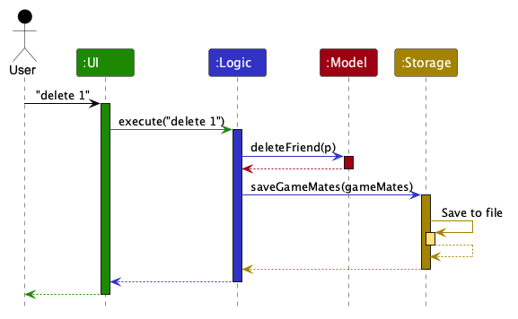
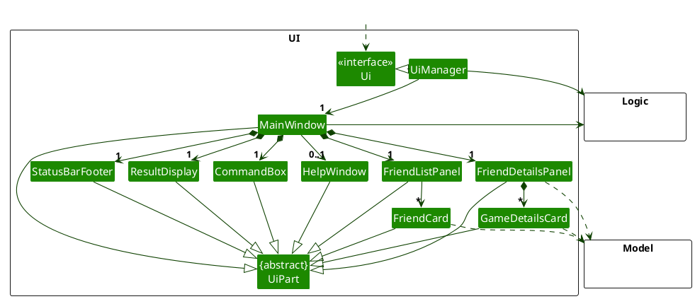
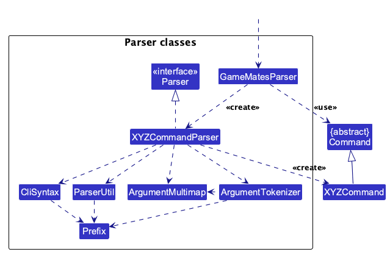
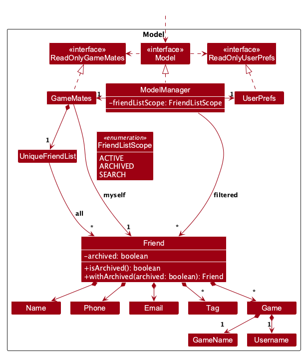
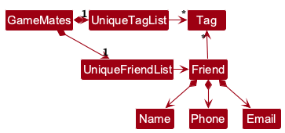
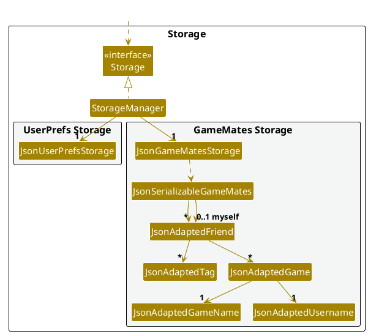
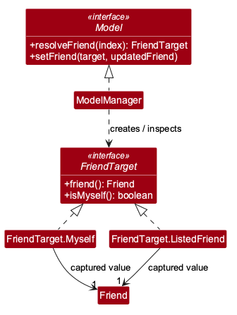
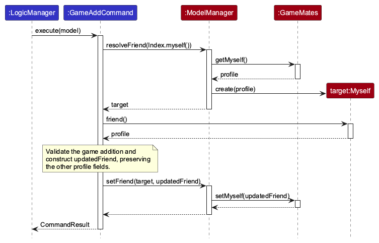
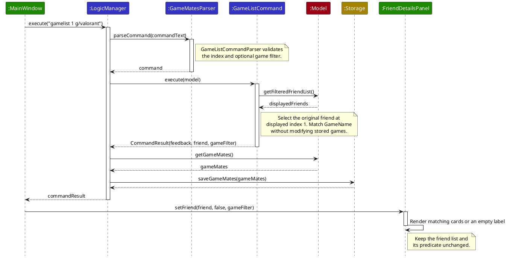

* Table of Contents
{:toc}

--------------------------------------------------------------------------------------------------------------------

## **Acknowledgements**

* [Vavr](https://vavr.io/) provides `Option`, `Try`, and checked-function adapters for parsing, edit descriptors, and storage.

This guide distinguishes implemented behaviour from the [pending MVP integration](#mvp-integration-and-specification-departures).
The requirements and explicitly proposed features below describe product goals, not a claim that every goal is implemented.

--------------------------------------------------------------------------------------------------------------------

## **Setting up, getting started**

Refer to the guide [_Setting up and getting started_](SettingUp.md).

--------------------------------------------------------------------------------------------------------------------

## **Design**

<div markdown="span" class="alert alert-primary">

:bulb: **Tip:** The `.puml` files used to create diagrams are in `docs/diagrams`. Refer to the [_PlantUML Tutorial_ at se-edu/guides](https://se-education.org/guides/tutorials/plantUml.html) to learn how to create and edit diagrams.
</div>

### Architecture


The ***Architecture Diagram*** given above explains the high-level design of the App.

The following provides a quick overview of the main components and their interactions.

**Main components of the architecture**

**`Main`** (consisting of classes [`Main`](https://github.com/AY2627S1-CS2103T-W14-3/tp/tree/master/src/main/java/seedu/address/Main.java) and [`MainApp`](https://github.com/AY2627S1-CS2103T-W14-3/tp/tree/master/src/main/java/seedu/address/MainApp.java)) is in charge of the app launch and shut down.
* At app launch, it initializes the other components in the correct sequence, and connects them up with each other.
* At shut down, it shuts down the other components and invokes cleanup methods where necessary.

The bulk of the app's work is done by the following four components:

* [**`UI`**](#ui-component): The UI of the App.
* [**`Logic`**](#logic-component): The command executor.
* [**`Model`**](#model-component): Holds the data of the App in memory.
* [**`Storage`**](#storage-component): Reads data from, and writes data to, the hard disk.

[**`Commons`**](#common-classes) represents a collection of classes used by multiple other components.

**How the architecture components interact with each other**

The *Sequence Diagram* below shows how the components interact with each other for the scenario where the user issues the command `delete 1`.



Each of the four main components (also shown in the diagram above),

* defines its *API* in an `interface` with the same name as the Component.
* provides its functionality through a concrete `{Component Name}Manager` class that implements the corresponding API interface.

For example, the `Logic` component defines its API in `Logic.java` and implements it in `LogicManager.java`. Other components interact with a component through its interface rather than its concrete class, preventing them from coupling to that component's implementation, as illustrated in the following partial class diagram.


The sections below give more details of each component.

### UI component

The **API** of this component is specified in [`Ui.java`](https://github.com/AY2627S1-CS2103T-W14-3/tp/tree/master/src/main/java/seedu/address/ui/Ui.java)



The UI consists of `MainWindow`, `CommandBox`, `ResultDisplay`, `FriendListPanel`, `FriendDetailsPanel`,
`GameDetailsCard`, `HelpWindow` and `StatusBarFooter`. These inherit from `UiPart`, which loads matching FXML layouts.
`MainWindow.fxml` keeps the observable friend list on the left of a `SplitPane` and the details panel on the right.
`FriendDetailsPanel` renders contact details, tags and sorted game cards. It does not replace the friend list.

The `UI` component uses the JavaFX UI framework. The layouts of these UI parts are defined in matching `.fxml` files in `src/main/resources/view`. For example, [`MainWindow.fxml`](https://github.com/AY2627S1-CS2103T-W14-3/tp/tree/master/src/main/resources/view/MainWindow.fxml) specifies the layout of [`MainWindow`](https://github.com/AY2627S1-CS2103T-W14-3/tp/tree/master/src/main/java/seedu/address/ui/MainWindow.java).

The `UI` component,

* executes user commands using the `Logic` component.
* listens for changes to `Model` data so that the UI can be updated with the modified data.
* keeps a reference to the `Logic` component, because the `UI` relies on the `Logic` to execute commands.
* depends on some classes in the `Model` component because it displays `Friend` objects from the model.

`FriendListPanel` sends selection changes to a consumer owned by `MainWindow`. Command-driven selection uses
`CommandResult.friendToShow`, `showMyself` and `gameFilter`, described under [Viewing games](#viewing-games).
Successful results without a friend payload show `Logic.getMyself()`. A single-result `find` selects that friend.
Parse or command failures update feedback without explicitly refreshing details. A game filter is applied only
while rendering cards, preserving both the model and the left-hand friend-list predicate.

### Logic component

**API** : [`Logic.java`](https://github.com/AY2627S1-CS2103T-W14-3/tp/tree/master/src/main/java/seedu/address/logic/Logic.java)

Here's a (partial) class diagram of the `Logic` component:


The sequence diagram below illustrates the interactions within the `Logic` component, taking `execute("delete 1")` API call as an example.


<div markdown="span" class="alert alert-info">:information_source: **Note:** The lifeline for `DeleteCommandParser` should end at the destroy marker (X), but due to a limitation of PlantUML, it continues to the end of the diagram.
</div>

How the `Logic` component works:

1. When `Logic` is called upon to execute a command, the command is passed to a `GameMatesParser` object, which in turn creates a parser that matches the command (e.g., `DeleteCommandParser`) and uses it to parse the command.
1. This results in a `Command` object (more precisely, an object of one of its subclasses e.g., `DeleteCommand`) which is executed by the `LogicManager`.
1. The command can communicate with the `Model` when it is executed (e.g. to delete a friend).<br>
   Note that although this is shown as a single step in the diagram above for simplicity, the code can require several interactions between the command object and the `Model` to complete the operation.
1. The command creates a `CommandResult`. `LogicManager` saves the complete `ReadOnlyGameMates` through `Storage`
   before returning it to the UI. Saving applies to viewing commands too. Parse and execution failures skip saving;
   an I/O error after execution is translated into a `CommandException` without rolling back the in-memory change.

Here are the other classes in `Logic` (omitted from the class diagram above) that are used for parsing a user command:



How the parsing works:
* When called upon to parse a user command, the `GameMatesParser` class creates an `XYZCommandParser` (`XYZ` is a placeholder for the specific command name, e.g., `AddCommandParser`). The parser uses the other classes shown above to parse the user command and create an `XYZCommand` object (e.g., `AddCommand`). The `GameMatesParser` returns that object as a `Command` object.
* All `XYZCommandParser` classes, such as `AddCommandParser` and `DeleteCommandParser`, implement the `Parser` interface so they can be treated similarly where appropriate, for example during testing.

#### Optional values

Command parsers and edit descriptors use Vavr `Option` to represent omitted values. A missing prefix
is absent, while a supplied prefix with an empty value is present and subject to validation. Add
commands default omitted contact details to `Phone.EMPTY` and `Email.EMPTY`. Edits preserve omitted
fields; a single empty `t/` clears the tags. Descriptor tag getters expose an unmodifiable set, and
setters retain defensive copies.

Parsing continues to report the first invalid value through `ParseException`. Vavr's checked-function
adapters propagate the original exception, so invalid input is never treated as an omitted argument.
`GameAddCommandParser` similarly defaults omitted `u/` to `Username.EMPTY`; a supplied blank `u/` is rejected.

#### Quoted values

`ArgumentTokenizer` lets users wrap a whole value in double quotes. Prefixes inside the quotes are literal text,
so `g/"PUBG n/Game"` gives `PUBG n/Game`.

* A value is quoted when its first character after trimming is `"`. Its content is trimmed like any value.
* In any value, `\"` is a literal `"`. Only the backslash right before a quote is removed, so `\\"` gives `\"`.
* A quoted value cannot end with `\` right before the closing quote, since `\"` is read as a literal `"`.
  Users add a space before the closing quote instead, which trimming removes.
* A bare `"` in an unquoted value, a missing closing quote or text after the closing quote throws a `ParseException`.
  Each case has its own message.
* Only straight quotes `"` are supported. Other quotes such as curly quotes `“ ”` do not start or end a quoted value.
  They are kept as normal text.
* The preamble is not parsed for quotes.

### Model component
**API** : [`Model.java`](https://github.com/AY2627S1-CS2103T-W14-3/tp/tree/master/src/main/java/seedu/address/model/Model.java)




The `Model` component,

* stores friends in `GameMates` through `UniqueFriendList`, plus a separate `Friend myself` profile with a default value.
  The profile is not in the friend list. Add/edit commands separately prevent names shared between a friend and the profile.
* exposes an observable `FilteredList<Friend>` backed by the stored friends. `FriendListScope` identifies active,
  archived or global search results, including empty lists. The filter is a predicate over the full collection,
  rather than a second collection of copied friends.
* stores each friend's games as `Game` objects, including their game name, username if provided and optional metadata.
* stores a `UserPrefs` object that represents the user’s preferences (currently, just the GUI settings). This is exposed to the outside as a `ReadOnlyUserPrefs` object.
* does not depend on any of the other three components (as the `Model` represents data entities of the domain, they should make sense on their own without depending on other components)

`Friend` contains `Name`, optional contact values, a set of `Tag` objects, a set of `Game` objects and an immutable
`archived` status and an immutable `pinned` state. See [Friend archiving](#friend-archiving) for scope, identity and
persistence rules. `UniqueFriendList` stably partitions friends after additions and
replacements so pinned friends are always before unpinned friends, while preserving the existing relative order
within each group. The filtered friend list is backed by this ordering, so the invariant also holds for filters.
`Game` contains `GameName`, `Username` and an immutable metadata set. Name equality ignores case and collapses repeated ASCII spaces;
`GameName.equals` compares complete names using lower-case normalization with `Locale.ROOT`.
`Username` preserves case and uses `Username.EMPTY` for omission, with `isEmpty()` to check it.
`Game.isSameGame` compares game names, while full equality also compares usernames and metadata.
`GameAddCommand` rejects an existing game name regardless of username. The set representation alone does not
enforce this rule when games with different usernames are loaded from JSON.

<div markdown="span" class="alert alert-info">:information_source: **Note:** The alternative, arguably more object-oriented, design below keeps a unique list of tags in `GameMates`, and each `Friend` references tags from that list. This lets `GameMates` maintain one `Tag` object per unique tag instead of each `Friend` holding its own `Tag` objects.<br>



</div>


### Storage component

**API** : [`Storage.java`](https://github.com/AY2627S1-CS2103T-W14-3/tp/tree/master/src/main/java/seedu/address/storage/Storage.java)



The `Storage` component,
* can save both GameMates data and user preference data in JSON format, and read them back into corresponding objects.
* is implemented by `StorageManager`, which delegates the actual JSON file access to `JsonGameMatesStorage` and `JsonUserPrefsStorage` (one class per data file).
* converts game metadata through `JsonAdaptedGame` and `JsonAdaptedMeta`, validating fields and rejecting duplicate keys when loading.
* depends on some classes in the `Model` component (because the `Storage` component's job is to save/retrieve objects that belong to the `Model`)

Storage reads return Vavr `Option`: missing files are absent, while malformed JSON or invalid stored
friend data still causes `DataLoadingException`. Vavr `Try` captures JSON read and model conversion
failures, translating captured failures into checked `DataLoadingException` instances with the original cause.
Startup uses sample data for a missing GameMates file
and an empty GameMates for a loading error. Missing or unreadable preferences use default preferences.
JSON contact fields that are null or empty map to the corresponding empty contact value. Invalid
nonempty contact values are rejected without trimming. Missing `games` or `tags` load as empty sets, and missing
`myself` retains `Friend.DEFAULT_MYSELF`. Stored games require a valid `name`. Missing, null or empty usernames
are mapped to `Username.EMPTY` and invalid non-empty values, including whitespace-only strings, are rejected.
Duplicate friend names reject the whole data load, including a previously parsed profile. Startup uses a new empty
`GameMates`.
`JsonAdaptedFriend` persists a friend's `pinned` boolean. The field is optional when loading: missing or `null`
values in save files created before pinning was introduced default to `false`.

`MainApp` resolves `data/gamemates.json` and `preferences.json` relative to the process working directory, not the
JAR's location. `MainApp.initPrefs` writes initialized preferences at startup and `stop` writes them again at shutdown.
`MainWindow.handleExit` first records the current window dimensions and position. The data model is saved by commands,
not by `stop`. Selection and filter predicates are transient.

`JsonSerializableGameMates` adapts both `friends` and `myself`. `JsonAdaptedFriend` adapts games and tags, and
`JsonAdaptedGame` adapts `name`, `username` and `metas`. Jackson ignores unknown properties, which
disappear on the next serialization. Loading a damaged file does not repair or back it up:
the next successful command can overwrite it with the fallback data. There is no automatic recovery or atomic
transaction spanning command execution and file writing.

Known loading exception: a JSON file containing only the literal `null` reaches `JsonUtil.readJsonFile`'s
`requireNonNull` outside its captured conversion, throwing `NullPointerException` rather than `DataLoadingException`.
It bypasses the normal empty-data fallback and can prevent startup. This needs an application fix separately;
the documentation change does not alter the loader.

### Common classes

Classes used by multiple components are in the `seedu.address.commons` package.

--------------------------------------------------------------------------------------------------------------------

## **Implementation**

This section describes some noteworthy details on how certain features are implemented.

### Friend creation, editing and deletion

`AddCommandParser` requires `n/` and uses `Phone.EMPTY` and `Email.EMPTY` for omitted contact values.
`ParserUtil` trims supplied values before calling their model validators. `ArgumentMultimap` rejects duplicate
single-value name/contact prefixes and collects repeated tags into a set. `UniqueFriendList` rejects names equal
under `Friend.isSameFriend`, so different phone/email values or tags do not distinguish duplicate names.

`EditCommandParser` requires a numeric index or case-insensitive `myself`. An omitted selector is rejected.
Target resolution and replacement use the [Myself profile mechanism](#myself-profile) described below.
Add/edit commands reject names shared between a friend and the profile. `EditFriendDescriptor` uses
optional values to distinguish omission from a supplied empty contact field. `EditCommand` constructs a new friend
with the original games. Name/contact values replace
existing values. Supplied tags are toggled by set membership. Duplicates in one command are deduplicated, and a
single empty `t/` clears all tags. Empty and non-empty tag parameters together fail validation.
After a successful add or friend edit, the model resets the friend-list predicate to show all friends.
Editing Myself preserves that predicate, including an empty displayed list.

`DeleteCommand` uses the same displayed-list indexing but keeps the current predicate. It removes the entire friend
and their games immediately; there is no confirmation state. Its out-of-range/empty-list error is the shared generic
message, while `EditCommand` and `GameListCommand` distinguish empty lists and give a displayed range.
`ClearCommand` replaces the friends with an empty `GameMates` while copying the existing profile.

The implemented contact rules differ from the submitted draft: names are 1–100 ASCII alphanumeric
characters/spaces, phones validate digit counts and grouping, and emails validate ASCII dot-atom/domain syntax
with length limits. The [User Guide](UserGuide.html#adding-a-friend-add) specifies the accepted input for users.
No phone, email, game name or username is verified against an external service.
`GameName` and `Username` values are trimmed with `String.strip()` and must contain a letter or digit.
Length is counted in UTF-16 units with `String.length()`. The shared text validator rejects:

* Unicode category C: controls, format characters, unpaired surrogates, private-use and unassigned characters
* line (Zl) and paragraph (Zp) separators
* characters that render blank: Hangul fillers U+115F, U+1160, U+3164 and U+FFA0, blank Braille U+2800
  and the combining grapheme joiner U+034F
* no-break spaces U+00A0, U+2007 and U+202F, which look like regular spaces but do not match them

Other Unicode is accepted, including combining marks, emoji and variation selectors.

### Myself profile

`GameMates` stores the user's profile as a separate `Friend`, initially `Friend.DEFAULT_MYSELF`.
`edit`, `gameadd` and `gamedel` accept `myself` independently of the displayed friend list and profile name.

Their syntax uses `FRIEND_INDEX|myself` for either a positive displayed friend index or the case-insensitive
profile keyword:

```text
edit FRIEND_INDEX|myself [n/NAME] [p/[PHONE_NUMBER]] [e/[EMAIL]] [t/TAG]…
gameadd FRIEND_INDEX|myself g/GAME_NAME [u/USER_NAME] [m/KEY:VALUE]…
gamedel FRIEND_INDEX|myself g/GAME_NAME
```

The sealed `FriendTarget` interface lets these commands update either the profile or a listed friend.
Its nested `Myself` and `ListedFriend` records retain the selected `Friend` and identify where to apply the update,
even if the friend-list filter changes.
The class diagram omits unrelated members and shows records as ordinary classes.



1. The three command parsers use `ParserUtil.parseIndexOrMyself`: case-insensitive `Index.MYSELF_KEYWORD`
   becomes `Index.myself()`. Numeric selectors remain displayed friend indices.
2. At execution, `ModelManager.resolveFriend(index)` captures the profile or currently displayed friend in a target.
3. After constructing a replacement `Friend` and completing validation, the command calls
   `ModelManager.setFriend(target, updatedFriend)`. An exhaustive switch routes `Myself` to the profile and
   `ListedFriend` to its captured friend.

For profile edits, `EditCommand` constructs the replacement before `FriendValidator` checks for name conflicts
with all stored friends, including those hidden by the current filter. Profile edits, `gameadd`, `gameedit`,
`gamedel` and `gamelist` preserve the friend-list filter.
`FriendValidator.checkFriendInitialized` rejects those four commands targeting `myself` until
`edit myself n/NAME` sets the profile name.

The sequence shows `gameadd myself g/Valorant u/player` after parsing. Helper calls and subsequent saving are omitted.



After success, `LogicManager` saves both `friends` and `myself` through `JsonSerializableGameMates`, and
`MainWindow` refreshes the profile via `Logic.getMyself()`. Missing `myself` in older JSON retains the default profile.

### Name and game filtering

`FindCommand` installs `NameContainsKeywordsPredicate`: any full name word matching any supplied keyword, ignoring
case, is sufficient. `ListCommand` either installs `PREDICATE_SHOW_ALL_FRIENDS` or `GameNameMatchesPredicate`, which
tests whether any of a friend's games has the exact `GameName`. Both operate over all stored friends and replace
the previous predicate; they do not intersect filters. `list s/name` and `list s/game` set a `SortedList` comparator
in `ModelManager` after filtering; `o/desc` reverses that comparator, while the default and `o/asc` are ascending.
The default `list` clears the comparator and retains stored insertion order. Game sorting uses each friend's
alphabetically first game name, with friends without games last and names as the tie-breaker. `find` does not parse
prefixes and `list` does not parse `n/`. The `find` parser only requires a
non-empty keyword list; there is no 255-character keyword validation. No-match queries return successful empty
results. Filtering and sorting never include or edit the separate profile.

### Editing an existing game

`GameEditCommandParser` reuses `ArgumentTokenizer`, `ArgumentMultimap`, `ParserUtil.parseIndexOrMyself`,
`parseGameName`, `parseUsername` and `parseMetas`. Its immutable `EditGameDescriptor` distinguishes omitted
metadata (`null`) from a supplied empty replacement set. A single empty `m/` clears metadata. All other
supplied pairs pass through the shared parser, including normalized duplicate-key checks and first-colon splitting.
The model identity rules remain unchanged. The merged optional-username model provides `Username.EMPTY`. A supplied empty `u/` maps to that value.
Omitting `u/` preserves the original username, including an absent username.

`GameEditCommand` uses `FriendTargetResolver` and `Model.resolveFriend` for displayed indices or Myself.
It requires exactly one matching existing game, constructs the complete replacement, then checks collisions
against the other games before calling `Model.setFriend(target, updated)` once. Ambiguous duplicate names in
externally edited JSON fail without mutation. `Friend.withGames` copies all current friend fields and defensively
copies the replacement set, including the original archive and pin statuses. Tests cover pinned order, archived
targets in archive and global search scopes, and save/reload preservation of both statuses. Its explicit copy
constructor must also copy any new fields introduced by future integrations.

The command retains the list predicate. A successful friend edit returns the updated friend through
`CommandResult`, clearing any old game-card filter. A successful profile edit uses the existing profile refresh.
Failures return no result and preserve the current details. `LogicManager` saves through the existing storage;
there is no new persistence mechanism or transaction spanning model mutation and a failing disk write.
Tests exercise command routing, atomic validation, displayed targets, metadata replacement, profile updates,
case-only spelling, UI refresh and real JSON storage round trips.

The [game edit sequence diagram source](diagrams/GameEditSequenceDiagram.puml) shows validation before mutation.

### Viewing a friend's games

`gamelist FRIEND_INDEX|myself [g/GAME_NAME]` selects a friend or the user profile for the right-hand details panel
without changing the left-hand friend list. The flow is:

1. `GameMatesParser` routes `gamelist` to `GameListCommandParser`. The parser requires one positional index or
   `myself` selector before at most one `g/` filter. Like other parsers, it uses `ArgumentTokenizer`, so all text
   after `g/` belongs to the name unless it is another ` g/`.
   Selector parsing uses `ParserUtil.parseIndexOrMyself`, and game validation uses the existing `GameName` rules.
   Index, repeated-prefix and game-name errors use the same shared messages as other commands.
2. `GameListCommand.execute` resolves the index against `Model.getFilteredFriendList()`, so indices remain correct
   after both name searches and game-based friend filtering. It checks empty and out-of-range lists before
   numeric lookup. `Model.resolveFriend` resolves the selected friend or the separate profile; `myself` works even with an empty displayed list.
   It uses `GameName.equals` for exact, case-insensitive matching. No match and no games return successful results.
3. `CommandResult` carries the original `Friend` in `friendToShow` and an optional `GameName` in `gameFilter`,
   plus `showMyself` to distinguish the profile from a friend with identical details.
   The filter requires a selected friend, participates in equality, hashing and diagnostic output, and defaults
   to empty in the existing constructors. Feedback uses the stored game name on a match and the trimmed query
   when there is no match.
4. `MainWindow.refreshFriendDetails` forwards the selected friend, profile flag and game filter to
   `FriendDetailsPanel.setFriend`.
   The panel filters the stream used to construct `GameDetailsCard` instances and displays an explicit empty label
   if the stream has no entries. It never constructs a replacement friend or modifies the original game set.
   An unfiltered command clears the game filter. The existing two-argument `setFriend` also clears it, including
   when `FriendListPanel` reports another selection. A single-result `find` continues selecting the whole friend.
   Parse and execution failures do not refresh the panel, preserving the previous game display.

The command does not update the model's friend-list predicate, friends, games, preferences or Myself profile.
The profile fallback still shows all profile games; explicit profile selection supports game filtering.
`GameDetailsCard` renders `Game.getGameName()`, `Game.getUsername()` and `Game.getMetas()`.
Metadata pairs appear below the username as wrapping `Key: Value` labels, sorted by key ignoring case.
The command's original-friend payload retains metadata without copying or removing it.

Parser and command tests cover errors, exact matching, empty results, displayed-list indexing and unchanged model
data. JavaFX panel and window tests exercise filtered payloads, empty states, clearing by commands and selection,
and preservation of the details view after invalid input.



### MVP integration and specification departures

Baseline: the *GameMates – Feature Specification* section of the team's
[shared project document](https://docs.google.com/document/d/1UI16NkQ8w8hXb-8Jez8UDpGYkRc8wbs42XZntx9n_sI/edit),
CS2103T-W14-3, 20 September 2026, pages 3–26 in the exported feature-spec PDF. Checked on 15 October 2026.
The table records unresolved differences for team reconciliation; it does not change application behaviour or
present pending PRs as merged features. Recheck this table and the User Guide against the integrated release
before publishing a complete v1.3 MVP guide.

| Area | Submitted specification | Current implementation / follow-up |
|------|-------------------------|------------------------------------|
| Own-profile editing | Omit `FRIEND_INDEX` in `edit` (pp. 10–13); the later task list instead mentions special `myself` handling. | Use <code>edit FRIEND_INDEX&#124;myself ...</code>. Omitting the selector is rejected. Update the earlier spec syntax to match this implementation. Profile and friend names must also differ. |
| Game add/delete | Add or delete a friend's game, with optional metadata on addition (pp. 17–23). | Use <code>gameadd FRIEND_INDEX&#124;myself g/GAME_NAME [u/USER_NAME] [m/KEY:VALUE]…</code> and <code>gamedel FRIEND_INDEX&#124;myself g/GAME_NAME</code>. See [Myself profile](#myself-profile). |
| Metadata | Case-insensitive unique keys, split at the first colon, trimmed key/value lengths of 1–50/1–200, each containing a letter or digit (pp. 19–20). | Model, parser utilities, JSON persistence, command entry through `gameadd`, replacement/clearing through `gameedit` and game-card rendering are implemented. See [Game metadata](#game-metadata) for the implemented API. |
| Tags | Supplied tags replace the full set (p. 11). | Supplied tags toggle individually. A single empty `t/` clears them. The team must choose whether to update the spec or implementation. |
| Friend names | 1–50 characters (pp. 5–6). | 1–100 ASCII alphanumeric characters/spaces. Duplicate comparison also collapses repeated spaces. A distinguishing tag does not make an equal name unique, and the spec's parenthesized-name workaround is rejected. |
| Phone/email | Phone: 1–40 characters from a broad punctuation set. Email: 1–255 characters containing `@` (pp. 5–6). | Phone: 3–15 ASCII digits, or `+` with 2–15, with constrained grouping and no extensions. Email: at most 254 characters, local part at most 64, ASCII dot-atom and valid domain labels. |
| Friend filtering | Combined `list [n/KEYWORDS] [g/GAME]`, with named empty-result feedback (pp. 14–15). | Separate `find KEYWORD...` and `list [g/GAME]`; a new command replaces the previous filter. Feedback is `Listed all friends.` or `N friend(s) listed!`, including zero. |
| GUI | Feature-spec mockups replace the friend panel with a game's list (pp. 15, 25); later v1.3 notes call for a split panel. | The adopted split layout matches those later notes: friends stay on the left and details/game cards appear on the right. `gamelist` filters cards only. Retire the earlier mockups. |
| Errors | Command-specific index and validation wording. | Messages differ across commands; use the verified wording in the User Guide instead of copying spec errors. |
| Game uniqueness | One or no username per game name within a friend (pp. 16–19). | `gameadd` rejects duplicate game names through `Game.isSameGame`. Stored sets use full equality, so JSON can still contain the same game name with different usernames. |

The audit's root-level JSON `null` loading issue remains unresolved. Game-text validation now rejects
control characters and misleading spaces.

Deletion confirmation and undo are not implemented. The confirmation user story below is a future requirement,
not a current use-case step. Game creation/deletion, metadata entry/display and own-profile editing are available.

### Game metadata

Metadata records game-specific details such as a friend's role or play style.
`Meta`, `MetaKey` and `MetaValue` are immutable classes in `seedu.address.model.game.meta`.
Each `Meta` contains one key and one value. `Game` copies the supplied metadata collection and
exposes it as an unmodifiable set through `getMetas()`. The two-argument constructor defaults to an empty set.

#### Validation and equality

`String.strip()` removes leading and trailing whitespace before validation and storage.
`StringUtil.isValidTextField()` requires at least one letter or digit. It rejects the characters listed in
[Friend creation, editing and deletion](#friend-creation-editing-and-deletion).
Limits use `String.length()` (UTF-16 units), so supplementary characters count as two.
`GameName` and `Username` also use this utility.

| Field | Length after trimming | Colon handling | Equality |
| --- | --- | --- | --- |
| `MetaKey` | 1–50 | Colons rejected | Case-insensitive using `Locale.ROOT` |
| `MetaValue` | 1–200 | Colons allowed | Case-sensitive |

Keys must be unique within each game entry, including when repeated pairs have identical values.
The same key can occur in other games or friends. `Game` enforces this invariant when constructed.
`Meta.equals()` compares both fields; `Game.equals()` includes metadata, while `isSameGame()` compares only the game name.

#### Parsing

`ParserUtil.parseMeta()` uses `StringUtil.splitAtFirstColon()` and delegates field parsing to
`parseMetaKey()` and `parseMetaValue()`. For example, ` Role : Support:Mid ` becomes key `Role` and value `Support:Mid`.
Missing separators and invalid fields cause `ParseException`.

`parseMetas()` parses a collection of raw values and rejects duplicate normalized keys before returning a set.
Callers must supply all raw values, without first deduplicating them, so identical repeated pairs are also rejected.
`GameEditCommandParser` uses these utilities for metadata replacement and handles a single empty `m/` as clearing.

`GameAddCommandParser` tokenizes the optional, repeatable `CliSyntax.PREFIX_META` (`m/`) alongside `g/` and `u/`.
It passes all raw metadata values to `parseMetas()` and constructs the `Game` with the validated set.
Omitting `m/` produces an empty set. Duplicate `g/` or `u/` prefixes remain invalid; repeated `m/` prefixes
are allowed only for distinct keys. Validation finishes before the command updates either a friend or the profile.

#### Display

`GameDetailsCard` displays each metadata pair as a wrapping `Key: Value` label below the username.
Pairs are sorted by key ignoring case, preserving the stored spelling and values. The metadata container
is hidden and unmanaged when empty. Both friend and profile details use these cards, including filtered game views.

#### Persistence and testing

`JsonAdaptedGame` stores metadata as a `metas` array of `JsonAdaptedMeta` objects:

```json
{
  "name": "Valorant",
  "username": "player",
  "metas": [{ "key": "Role", "value": "Support:Mid" }]
}
```

Missing or null `metas` fields load as an empty set, preserving compatibility with existing save files.
Null array entries, invalid fields and duplicate keys cause `IllegalValueException` during model conversion.

Tests cover trimmed length boundaries, Unicode, control characters, colons, case normalization,
duplicate keys, immutability, JSON round-trips and metadata preservation during contact edits.
Command tests also cover optional and interleaved metadata flags, malformed input, and addition with metadata
to displayed friends and `myself`, including filter preservation, duplicate-game rejection and JSON round-trips.
`GameBuilder.addMeta("Role", "Support")` appends a pair; `withMetas(...)` replaces the collection.
Duplicate keys added through the builder are rejected by `build()`.

### \[Proposed\] Undo/redo feature

#### Proposed Implementation

The proposed undo/redo mechanism is facilitated by `VersionedGameMates`. It extends `GameMates` with an undo/redo history, stored internally as an `gameMatesStateList` and `currentStatePointer`. Additionally, it implements the following operations:

* `VersionedGameMates#commit()` — Saves the current GameMates state in its history.
* `VersionedGameMates#undo()` — Restores the previous GameMates state from its history.
* `VersionedGameMates#redo()` — Restores a previously undone GameMates state from its history.

These operations are exposed in the `Model` interface as `Model#commitGameMates()`, `Model#undoGameMates()` and `Model#redoGameMates()` respectively.

Given below is an example usage scenario and how the undo/redo mechanism behaves at each step.

Step 1. The user launches the application for the first time. The `VersionedGameMates` will be initialized with the initial GameMates state, and the `currentStatePointer` pointing to that single GameMates state.


Step 2. The user executes `delete 5` command to delete the 5th friend in the GameMates. The `delete` command calls `Model#commitGameMates()`, causing the modified state of the GameMates after the `delete 5` command executes to be saved in the `gameMatesStateList`, and the `currentStatePointer` is shifted to the newly inserted GameMates state.


Step 3. The user executes `add n/David …​` to add a new friend. The `add` command also calls `Model#commitGameMates()`, causing another modified GameMates state to be saved into the `gameMatesStateList`.


<div markdown="span" class="alert alert-info">:information_source: **Note:** If a command fails its execution, it will not call `Model#commitGameMates()`, so the GameMates state will not be saved into the `gameMatesStateList`.

</div>

Step 4. The user now decides that adding the friend was a mistake, and decides to undo that action by executing the `undo` command. The `undo` command will call `Model#undoGameMates()`, which will shift the `currentStatePointer` once to the left, pointing it to the previous GameMates state, and restores the GameMates to that state.


<div markdown="span" class="alert alert-info">:information_source: **Note:** If the `currentStatePointer` is at index 0, pointing to the initial GameMates state, then there are no previous GameMates states to restore. The `undo` command uses `Model#canUndoGameMates()` to check if this is the case. If so, it will return an error to the user rather
than attempting to perform the undo.

</div>

The following sequence diagram shows how an undo operation goes through the `Logic` component:


<div markdown="span" class="alert alert-info">:information_source: **Note:** The lifeline for `UndoCommand` should end at the destroy marker (X), but due to a limitation of PlantUML, it continues to the end of the diagram.

</div>

Similarly, how an undo operation goes through the `Model` component is shown below:


The `redo` command does the opposite — it calls `Model#redoGameMates()`, which shifts the `currentStatePointer` once to the right, pointing to the previously undone state, and restores the GameMates to that state.

<div markdown="span" class="alert alert-info">:information_source: **Note:** If the `currentStatePointer` is at index `gameMatesStateList.size() - 1`, pointing to the latest GameMates state, then there are no undone GameMates states to restore. The `redo` command uses `Model#canRedoGameMates()` to check if this is the case. If so, it will return an error to the user rather than attempting to perform the redo.

</div>

Step 5. The user then decides to execute the command `list`. Commands that do not modify the GameMates, such as `list`, will usually not call `Model#commitGameMates()`, `Model#undoGameMates()` or `Model#redoGameMates()`. Thus, the `gameMatesStateList` remains unchanged.


Step 6. The user executes `clear`, which calls `Model#commitGameMates()`. Since the `currentStatePointer` is not pointing at the end of the `gameMatesStateList`, all GameMates states after the `currentStatePointer` will be purged. Reason: It no longer makes sense to redo the `add n/David …​` command. This is the behavior that most modern desktop applications follow.


The following activity diagram summarizes what happens when a user executes a new command:


#### Design considerations:

**Aspect: How undo & redo execute:**

* **Alternative 1 (current choice):** Saves the entire GameMates.
  * Pros: Easy to implement.
  * Cons: May have performance issues in terms of memory usage.

* **Alternative 2:** Individual command knows how to undo/redo by
  itself.
  * Pros: Will use less memory (e.g. for `delete`, just save the friend being deleted).
  * Cons: We must ensure that the implementation of each individual command is correct.

### Friend archiving

Archiving hides a friend from the active list while preserving their contact details, tags, games, optional
usernames and game metadata. `archive FRIEND_INDEX`, `unarchive FRIEND_INDEX` and
`archivelist [g/GAME_NAME]` are implemented. This feature is separate from backing up the JSON data file;
automatic backups, scheduled retention and undo are not implemented.

#### Stored status and identity

`GameMates` keeps active and archived friends together in one `UniqueFriendList`. `Friend.isArchived()` exposes
an immutable boolean; `withArchived(boolean)` returns a copy with all other fields preserved. `Friend.equals()`
and `hashCode()` include archive status, while `isSameFriend()` continues to compare normalized names.

Names must be unique across active and archived friends combined, and must differ from the separately stored
Myself profile. An archived name stays reserved. `FriendValidator` rejects a conflicting add or rename and
suggests `archivelist` and `unarchive` when the existing friend is archived. It uses `Model.findFriend()` to obtain
that stored friend in one identity lookup across both statuses, independent of the current display filter. Editing the existing friend while
retaining their own name is allowed. Myself cannot be archived or restored.

#### Display scope and filtering

`ModelManager` stores a `FriendListScope` independently of the displayed list contents:

| Scope | Entered by | Predicate |
| --- | --- | --- |
| `ACTIVE` | Startup, `list [g/GAME_NAME]`, adding a friend | Not archived, combined with an optional game predicate |
| `ARCHIVED` | `archivelist [g/GAME_NAME]` | Archived, combined with an optional game predicate |
| `SEARCH` | `find KEYWORD [MORE_KEYWORDS]` | Name keywords across both statuses |

`ListCommandParser` and `ArchiveListCommandParser` share `ParserUtil.parseOptionalGameFilter()` and
`GameNameMatchesPredicate`. Game matching is exact and case-insensitive, with the same validation rules for both
commands. Name matching remains a global `find` operation. Each `list`, `archivelist` or `find` command replaces
the previous predicate. `gamelist` preserves the friend-list filter.
Unfiltered empty archives give guidance on archiving; filtered empty results report that no archived friends
match the game filter.

The logic layer exposes `getFriendListScope()` to the UI. `MainWindow` updates the heading to **Active friends**,
**Archived friends** or **Search results**. `FriendCard` shows an **Archived** badge when applicable.

#### Archive and restore execution

1. The command parser accepts one positive displayed index; `myself` and extra arguments are rejected.
1. `ArchiveCommand` rejects the archive-only scope with guidance to run `list`. Active lists and global search
   results accept archiving. `UnarchiveCommand` accepts an archived target in archive or search results.
1. The command checks the index against the currently displayed list and rejects an invalid index or an
   already archived/non-archived target as appropriate. Failed commands preserve the data, scope and filter.
1. `Model.setFriend()` replaces the selected friend with a copy carrying the new archive status.
1. The observable filtered list updates automatically. Archiving removes a friend from an active-only list;
   restoring removes a friend from an archive-only list. In global search, the friend remains at the same
   displayed position with updated status. Neither command resets the predicate or scope.
1. `LogicManager` saves the updated collection through the existing storage path.

`edit`, `gameadd`, `gameedit` and `gamedel` preserve archive status when constructing replacement friends.
`gameedit` retains the current scope and predicate. Friend edits clear
filters within active/archive scopes, while global searches retain their name predicate. Renaming a search
result can therefore remove it from the results. `delete` permanently removes the selected friend from either
status; `clear` removes both statuses while preserving Myself.

#### Persistence and design considerations

`JsonAdaptedFriend` saves `archived` as a boolean on each friend. Missing status in older files defaults to
`false`. Restarting restores every friend's status and details, but starts in the unfiltered active scope.
Display scope and predicates are not persisted.

A single stored collection keeps identity validation, storage and archive/restore updates on the existing
model path. The alternative is separate stored active and archive collections, requiring transfers, cross-list
uniqueness checks and a different JSON representation. Rebuilding a filtered view scans the underlying
collection; separate collections could reduce the scan for active-only views, but global name search would
still examine both. The current design favours simpler state management; change it if measurements establish
a performance need.

Regression coverage includes mixed-status searches, filtered displayed indices, invalid targets, empty archive
feedback, identity conflicts, editing archived friends and save/reload restoration of complete game data.


--------------------------------------------------------------------------------------------------------------------

## **Documentation, logging, testing, dev-ops**

* [Documentation guide](Documentation.md)
* [Testing guide](Testing.md)
* [Logging guide](Logging.md)
* [DevOps guide](DevOps.md)

--------------------------------------------------------------------------------------------------------------------

## **Appendix: Requirements**

### Product scope

**Target user profile**:

* Play multiple online or multiplayer games.
* Have many gaming friends across different games or platforms.
* Want to remember each friend's in-game usernames, preferred roles, servers, play styles, or other game-specific details.
* Prefer using a command-line interface over navigating menus and mouse interactions.
* Prefers a desktop application for managing gaming contacts.
* Is comfortable typing commands to manage information quickly.
* Still wants a simple visual interface to view their friend and game information clearly.

**Value proposition**: Manage gaming friends and their game-specific details faster than generic contacts apps, spreadsheets, or chat history searches.


### User stories

These are product requirements, including future work. Implemented availability is recorded in the integration table above.

Priorities: High (must have) - `* * *`, Medium (nice to have) - `* *`, Low (unlikely to have) - `*`

| Priority | As a …​                          | I want to …​                                            | So that I can…​                                                   |
|----------|----------------------------------|--------------------------------------------------------|------------------------------------------------------------------|
| `* * *`  | new user                         | see usage instructions                                 | refer to instructions when I forget how to use the App           |
| `* * *`  | gamer                            | add a gaming friend                                    | remember the people I play games with                            |
| `* * *`  | gamer                            | delete a friend                                        | remove friends I no longer play with                             |
| `* * *`  | gamer                            | list all my friends                                    | see everyone I have saved at a glance                            |
| `* * *`  | gamer                            | edit a friend's details                                | keep their information up to date                                |
| `* * *`  | gamer                            | add games to a friend's entry                          | remember what games they play                                    |
| `* * *`  | gamer                            | remove games from a friend's entry                     | know which games they no longer play                             |
| `* * *`  | gamer                            | add a friend's in-game username for a game or platform | know what name to search for when inviting them                  |
| `* * *`  | gamer                            | edit a friend's platform handle                        | keep it up to date when they change their username               |
| `* * *`  | gamer                            | search for a friend by name                            | find the people I want without scrolling through the whole list  |
| `* * *`  | gamer                            | filter my friends by game or platform                  | quickly find friends relevant to what I am currently playing     |
| `* * *`  | gamer                            | add my own details                                     | see how I fit into the context of my friends                     |
| `* * *`  | gamer                            | edit my own details                                    | keep my profile accurate as my games and usernames change        |
| `* * *`  | gamer                            | have my data saved automatically                       | keep my friend list after closing the App                        |
| `* *`    | gamer                            | be asked to confirm before deleting a friend           | avoid deleting someone by accident                               |
| `* *`    | gamer                            | be warned when adding a friend who already exists      | avoid duplicate entries                                          |
| `* *`    | gamer                            | see which games my friends and I have in common        | decide what to play together                                     |
| `* *`    | gamer who plays many games       | see all the games a friend plays                       | know which games I can invite them to                            |
| `* *`    | gamer                            | record a friend's preferred role (e.g. support, tank)  | put together a balanced team                                     |
| `* *`    | gamer                            | record the server or region a friend plays on          | invite only friends who can join my lobby                        |
| `* *`    | gamer                            | record a friend's rank in a game                       | find friends at a similar skill level                            |
| `* *`    | gamer                            | add notes about a friend's play style                  | remember who is casual and who is competitive                    |
| `* *`    | gamer                            | tag friends (e.g. "duo", "casual")                     | group them in ways that suit me                                  |
| `* *`    | expert user                      | use shorter command aliases                            | manage my friends even faster                                    |
| `*`      | gamer with many friends          | sort friends by name                                   | locate a friend easily                                           |
| `*`      | gamer                            | mark friends as favourites                             | find my regular teammates first                                  |
| `*`      | gamer with friends abroad        | record a friend's time zone                            | know when they are likely to be online                           |
| `*`      | gamer                            | undo my last command                                   | recover from mistakes quickly                                    |
| `*`      | gamer                            | record when I last played with a friend                | reconnect with friends I have not played with in a while         |
| `*`      | gamer                            | export my friend list                                  | back up my data or move it to another computer                   |

### Use cases

(For all use cases below, the **System** is `GameMates` and the **Actor** is the `user`, unless specified otherwise)

**Use case: Add a friend**

**MSS**
1. User requests to add a friend, providing a name.
2. GameMates adds the friend to the list and shows a confirmation.

   Use case ends.

**Extensions**
* 1a. The name field is missing or empty.

  * 1a1. GameMates shows an error message.

    Use case ends.
* 1b. A friend with the same name already exists.

  * 1b1. GameMates shows `This friend already exists in GameMates.`

    Use case resumes at step 1.


**Use case: Delete a friend**

**MSS**
1. User requests to list friends.
2. GameMates shows a list of friends.
3. User requests to delete a specific friend in the list.
4. GameMates immediately deletes the friend and their game entries and shows `Successfully deleted NAME.`

   Use case ends.

**Extensions**
* 2a. The list is empty.

  Use case ends.
* 3a. The given index is invalid.

  * 3a1. GameMates shows an error message.

    Use case resumes at step 2.
**[Proposed] Use case: Edit a friend's platform handle**

This is a future requirement; there is no working handle-editing command in this checkout.

**MSS**
1. User requests to list friends.
2. GameMates shows a list of friends.
3. User requests to edit a specific friend's handle for a platform, providing the new handle.
4. GameMates updates the handle and shows a confirmation.

   Use case ends.

**Extensions**
* 2a. The list is empty.

  Use case ends.
* 3a. The given index is invalid.

  * 3a1. GameMates shows an error message.

    Use case resumes at step 2.
* 3b. The specified platform does not exist for that friend.

  * 3b1. GameMates shows an error message.

    Use case resumes at step 2.


**Use case: Search for a friend**

**MSS**
1. User requests to search for friends matching a keyword.
2. GameMates shows a list of friends matching the keyword.

   Use case ends.

**Extensions**
* 1a. No keyword is given.

  * 1a1. GameMates shows an error message.

    Use case ends.
* 2a. No friends match the keyword.

  Use case ends.


**Use case: Filter friends by game**

**MSS**
1. User requests to filter friends by a specific game.
2. GameMates shows a list of friends who play that game.

   Use case ends.

**Extensions**
* 2a. No friends play that game.

  Use case ends.

### Non-Functional Requirements

These requirements are targets, not measured guarantees. Capacity and performance require separate validation.

#### Environment

1. Should run offline on a single user's personal laptop running a _mainstream OS_, requiring only Java `25` or above.
1. Should display all panels and the command box without scrolling at the default window size on screens with a resolution of `1280 x 720` or higher.

#### Data

1. Should store all data locally in human-editable JSON files and send no data over the network.
1. Should save data after successful commands and window preferences on shutdown, restoring saved data on the next launch from the same working directory.
1. Should start without crashing, using sample data if the data file is missing or an empty list if it is corrupted.

#### Capacity

1. Should support up to 1000 friends in total across the active and archived lists, excluding the user profile, each with up to 100 game entries.

#### Performance

On a _modern computer_ running Java `25`, with up to 1000 friends in total across the active and archived lists, excluding the user profile, and 100 game entries per friend:

1. Should be ready to accept commands within 3 seconds of launch.
1. Should display friend listing or filtering results within 2 seconds of command submission.

#### Usability

1. Users with above-average typing speed for regular English text should be able to add, edit, delete, list and filter friends, and add, delete and list game entries, faster using commands than the mouse.
1. First-time users should be able to add a friend and a game entry for that friend within 5 minutes of launch, using only the in-app help and sample data.
1. Invalid commands should explain the error and show the correct usage or allowed input range, without modifying data.
1. All commands in the User Guide should be usable through the command box alone.

#### Constraints

1. Friend names, game names, usernames and metadata are user-provided and are not verified against online gaming platforms.

### Glossary

* **Modern computer**: A computer running a mainstream OS with 16 GB of RAM, a 512 GB SSD, and a mid-range modern processor such as an Intel Core i5 or AMD Ryzen 5.
* **Mainstream OS**: Windows, Linux, Unix, or macOS
* **Friend**: A person stored in GameMates, identified by a unique name and optionally associated with contact details and game entries.
* **User profile**: The current user's separately stored details, edited using `edit myself ...` and preserved by friend-list commands.
* **Game entry**: A record that a friend plays a game, containing a game name, in-game username and optional metadata.
* **Role**: A job or duty a friend plays as in a particular game, for example a friend can play as a `Sniper` or a `Healer`.
* **Game name**: The user-provided name used to identify a game within one friend’s game entries. Aliases such as “Val” and “Valorant” are treated as different game names.
* **In-game username/Handle**: The name/alias a friend uses within a particular game. It may not refer to their real name and can be different for different games.
* **Metadata**: Additional stored information for a game entry, such as a role, preferred weapon, server or play style; entered through `gameadd` using `m/KEY:VALUE`, replaced or cleared through `gameedit`, and displayed below the username in game cards.
* **Metadata key**: The label before the first colon in a metadata item. For example, `Role` in `Role:Sentinel`.
* **Metadata value**: The information after the first colon in a metadata item. For example, `Sentinel` in `Role:Sentinel`.
* **Friend index**: A positive number representing a friend’s position in the currently displayed friend list.
* **Currently displayed list**: The friend list currently shown after any active filters have been applied. Friend indices refer to this list.
* **Filter**: A condition used to narrow a displayed list, such as a name keyword or game name.
* **Name keyword**: A full word matched against a friend's name, ignoring case. A substring such as `Dav` does not match `David`.
* **Case-insensitive comparison**: A comparison that treats uppercase and lowercase letters as equivalent.
* **Trimmed value**: A value after its leading and trailing spaces have been removed.
* **Duplicate**: Two entries considered the same according to the project’s matching rules, and therefore not both allowed.

--------------------------------------------------------------------------------------------------------------------

## **Appendix: Instructions for manual testing**

### Prerequisites and test isolation

Use JDK 25 and a graphical desktop. Build with `./gradlew shadowJar`, then copy `build/libs/gamemates.jar` into
an empty disposable folder. Open a terminal in that folder and run `java -jar gamemates.jar`.
Never use a real user's data for deletion, corruption or write-failure tests. Use a new disposable folder for each
scenario labelled **fresh sample data**; do not run two app instances against the same data file.
Commands below are entered in the application's command box, not the terminal.

### Launch, help and window settings

Prerequisite: fresh sample data.

1. Launch from the disposable folder. Expected: six sample friends on the left; the right panel says
   `Your details` and `No details added`. A missing data file is not a crash.
2. Enter `help`. Expected: feedback `Opened help window.`, a Help window containing the User Guide URL and
   **Copy URL** button. Copy and open it in a browser. Close the Help window and press `F1` to reopen it.
3. Resize/move the main window, then enter `exit`. Relaunch from the same folder.
   Expected: saved size/position restored, all friends visible, default profile on the right.

### Friend creation, editing, identity and tags

Prerequisite: fresh sample data. These steps deliberately add a disposable friend.

| Step | Input/action | Expected result |
|------|--------------|-----------------|
| 1 | `add n/Joash Test t/duo` | Seven friends. Feedback starts `Added Joash Test.` and shows `Not provided` for phone and email. |
| 2 | `add n/joash   test t/other` | Duplicate-name error; still seven friends. A different tag does not bypass identity checks. |
| 3 | `find Joash`, then `edit 1 p/+65 9123-4567 e/joash@example.com t/duo t/casual` | Edits Joash rather than full-list friend 1. All seven friends become visible. Games remain unchanged; `duo` is removed and `casual` added. |
| 4 | `find Joash`, then click the result | Right panel shows the formatted phone, email and only `casual`. |
| 5 | `edit 1 p/ e/ t/casual t/casual` | Phone/email removed; `casual` toggled off once. Feedback lists removed details. |
| 6 | `find Joash`, then `edit 1 t/duo t/casual`, then `find Joash`, then `edit 1 t/` | Both tags are added, then all are cleared. Omitted name/contact fields are preserved. |
| 7 | `find Joash`, then `gamelist 1` | `Joash Test has no games added yet.` and a `No games added` label. |

Test invalid input independently: `add`, `add n/`, `add n/Joash-Test`, `add n/Test p/`, `add n/Test p/12`,
`add n/Test p/9123.4567`, `add n/Test p/123;4`, `add n/Test e/name@`, `add n/Test e/a..b@example.com`,
`add n/Test n/Test`, and `edit 1 t/ t/duo`. Expected: validation or duplicate-prefix errors and no stored change.
Also try 100 versus 101 ASCII letters for a name, 15 versus 16 phone digits, and email local parts of 64 versus 65
letters followed by `@example.com`. Expected: the first in each pair is valid and the second rejected, using fresh
names or a disposable friend for each attempt. These are syntax checks, not online contact verification.

### Friend filters and displayed indices

Prerequisite: fresh sample data.

1. `find alex david`: expected Alex Yeoh and David Li, with `2 friend(s) listed!`.
2. `find Dav`: expected zero results; substring matching is not supported. `find david` returns David and opens
   his details automatically. `find` without keywords reports usage and preserves the current display.
3. `list g/minecraft`: expected Bernice Yu and Roy Balakrishnan, replacing the David filter.
4. `gamelist 1`: expected Bernice's Minecraft card, although Bernice was full-list index 2. Both Minecraft players
   remain on the left. `find Alex` now finds Alex from the full data, not from the two Minecraft results.
5. `list g/Val`: expected zero results. `list` restores all six friends and returns `Listed all friends.`.
6. `list n/Alex g/Valorant`: expected invalid-format feedback; combined filtering is not supported.

### Game cards, empty states and display-filter clearing

Prerequisite: fresh sample data.

1. `gamelist 1`: expected Alex's Fortnite and Valorant cards, each showing a game name and username.
2. `gamelist 1 g/valorant`: expected `Showing Valorant for Alex Yeoh:` and only his Valorant card.
3. `gamelist 0`, then `gamelist 2147483648`, then `gamelist 7`: expected index errors; the existing Valorant
   card stays visible. Try `gamelist`, `gamelist 1 g/`, `gamelist 1 g/Valorant g/Valorant`,
   `gamelist 1 x/Valorant`, and `gamelist 1 extra`: expected the corresponding usage, empty-name or repeated-filter error.
4. `gamelist 1 g/Val`: expected `Alex Yeoh does not have Val.` and `No matching game: Val`. This is successful,
   not an exception. Alex's contact details remain visible, and the left list still has six friends.
5. `gamelist 1`: expected both cards again. Filter to Valorant again, then click Bernice: expected her Minecraft card,
   proving that selecting another friend clears the display filter. No stored game entry should be removed.
6. `gamelist 3 g/Stardew Valley`: expected Charlotte's Stardew Valley card. `find David`, then `gamelist 1`,
   selects David rather than Alex. `list g/Unknown`, then `gamelist 1`, reports an empty displayed list.
7. `gamelist myself`: expected `Your details` and all profile games. `gamelist myself g/Valorant` shows only
   your Valorant card if present. `find Unknown`, then `gamelist MYSELF`, still selects your profile with the empty
   friend list unchanged. `gamelist myself g/Unknown` reports no match. If no profile details exist, the panel
   continues showing `No details added`.

### Deletion and clearing

Prerequisite: fresh sample data. These actions are destructive within the disposable folder.

1. `list g/Minecraft`, then `delete 1`: expected Bernice is removed immediately, with
   `Successfully deleted Bernice Yu.`. No confirmation appears. Roy remains in the filtered list, and other friends
   reappear with `list`. Bernice's games are removed with her, while Roy's Minecraft entry remains.
2. `delete`, `delete 0`, `delete -1`, `delete x`, `delete 2147483648`, `delete 1 2` and `delete 999`:
   expected errors without deleting anyone. Missing index reports `Please provide an index.`; malformed values
   report `Index must be a positive integer.`; an out-of-range index reports `The friend index provided is invalid.`.
3. `clear`: expected immediate empty list and `Friend list has been cleared!`. `delete 1` then reports the generic
   invalid-displayed-index error; `edit 1 n/Test` and `gamelist 1` report an empty displayed list. There is no undo.

### Saved profile and game round trip

Prerequisite: a disposable app folder. Close the app and create `data/gamemates.json` with the fixture below.
This seeds existing data for testing; it is not an own-profile edit command.

```json
{
  "friends": [{
    "name": "Fixture Friend", "phone": "", "email": "", "tags": ["duo"],
    "games": [{"name": "Valorant", "username": "friend123"}]
  }],
  "myself": {
    "name": "Joash", "phone": "91234567", "email": "joash@example.com", "tags": [],
    "games": [{"name": "Minecraft", "username": "joash123"}]
  }
}
```

1. Relaunch: expected Joash's profile and Minecraft username on the right. `gamelist 1` shows Fixture Friend's
   Valorant entry. `edit 1 p/98765432` preserves that entry and shows the unchanged profile after success.
2. `list g/Unknown`, then `edit MYSELF n/Joash Updated p/`: expected the renamed profile with no phone number and
   its Minecraft game preserved. The left friend list remains empty. `edit myself n/Fixture Friend` rejects the
   duplicate name, and `add n/joash updated` rejects a name matching the profile.
3. Try `edit n/Changed`: expected a missing-index error. Run `gameadd myself g/Test u/player m/Role:Support:Mid`, then
   `gamelist myself g/Test`: expected `Role: Support:Mid` in the addition feedback and below the username in the game card.
   Run `gamedel myself g/Test`: expected success and the original Minecraft entry preserved.
   To also test loading metadata from JSON, close the app, add
   `"metas": [{"key": "Role", "value": "Support:Mid"}]` to the fixture's Minecraft entry, relaunch and run `list`.
   The saved JSON must retain that pair; cards show the game name and `Username: Not provided` when the username is omitted.
   A missing `metas` field loads as empty; a repeated key (including case variants) rejects the load and uses the documented fallback.
4. Run `gameadd myself g/Test` without `u/`: expect success with `Username: Not provided` in feedback and the game card.
   `gameadd myself g/Other u/` must fail. Exit and relaunch; the Test game must retain its empty username.
5. `find Fixture`, then `gamelist 1 g/valorant`, then `exit`. Relaunch from the same folder.
   Expected: the edited friend phone, friend game and profile game survive, with Joash Updated's profile displayed
   and its phone still removed. Filters are reset.
6. `clear`, then `exit` and relaunch. Expected: no friends, but the same updated profile and Minecraft username.

### Missing, invalid and unwritable files

Prerequisite: independent disposable app folders and closed app instances before each file edit.

| Setup and action | Expected result |
|------------------|-----------------|
| Start in an empty folder without `data/gamemates.json`; enter `list`. | Six sample friends and a default profile; the successful command creates the data file. |
| Save the fixture above, close the app, copy the data file to a backup, then replace its contents with `{broken`. Relaunch without entering commands. | Empty friends and default profile; the malformed file stays on disk. No automatic backup or recovery prompt. Close the app and restore the backup to recover. |
| Repeat the invalid-file setup, then enter `list`. | `Listed all friends.` with an empty list; the file is overwritten with the empty fallback data. |
| In a separate disposable folder, replace the data file with the literal `null`, then launch. | Known defect: startup can fail with an uncaught null-value error instead of the empty-data fallback. Restore a valid backup to continue. |
| In a copy of the valid fixture, use an invalid phone such as `12`, or duplicate the friend with an equal name. Relaunch. | The whole data load fails; empty friends and default profile. Restore the backup before continuing. |
| Remove the `myself` and `games` properties from a valid copy, then relaunch. | Default profile and a friend with no games. Empty/missing phone and email are accepted; invalid non-empty contacts are not. |
| Copy the same JAR to a second empty folder and launch there. | A separate sample dataset, not the first folder's saved friends. Restore a backup into the second folder to transfer data. |
| With the app running, make its data file unwritable for that user (for example `chmod a-w data/gamemates.json` on Linux/macOS). Enter `add n/Unsaved Test`. | A `Could not save data` error. The friend may already be visible in memory; this is not a rolled-back transaction. |
| Restore write access (`chmod u+w data/gamemates.json`), enter `list`, then exit and relaunch. | The in-memory change is saved and the new friend reloads. Test permissions as a normal user, not root. |

### Documentation preview

Use the repository's Jekyll workflow locally with Ruby 3.3 and Bundler:

```sh
cd docs
bundle install
JEKYLL_ENV=production bundle exec jekyll build --baseurl /tp --destination /tmp/gamemates-docs-site
```

Serve the generated directory under `/tp/` when checking links, or build with an empty base URL for a local root
preview. Inspect the User Guide, Developer Guide and home page in a browser: tables, command brackets, code blocks,
TOC anchors, screenshots, diagrams and mobile-width overflow. The existing `Build docs PR preview` workflow runs
on open PRs labelled `type.Docs`; this task does not publish a preview or change workflows.

Current screenshots must come from the application, not the specification mockups. `Ui.png` shows both panels,
`findAlexDavidResult.png` shows name filtering, and `gamelistFiltered.png` / `gamelistNoMatch.png` show card filtering.
Diagram sources live in `docs/diagrams`; regenerate their matching `docs/images/*.png` after changing a source.

### Manual game edit checks

Use a disposable data directory. Add `add n/Tester`, `gameadd 1 g/Valorant u/tester` and
`gameadd 1 g/Minecraft u/builder`. Edit with `gameedit 1 g/Valorant n/VALORANT u/newPlayer m/Role:Healer`.
Expect both games and preserved friend fields. Try `gameedit 1 g/Valorant n/Minecraft` and repeated
normalized metadata keys; expect errors with unchanged data and details. Clear with `gameedit 1 g/Valorant m/`.
Add `gameadd myself g/Valorant u/own`, run `find Nobody`, then `gameedit myself g/Valorant u/newOwn`;
expect updated profile despite the empty list. Restart from the same directory and confirm all edits persist.

To check literal prefixes, run `list`, then add both `gameadd 1 g/PUBG u/plain` and
`gameadd 1 g/PUBG n/Game u/special`.
Run `gameedit 1 g/"PUBG n/Game" u/updated`: only `PUBG n/Game` should change; the plain `PUBG` entry must
retain username `plain`. Rename the quoted target using `n/"PUBG m/Edition"` and edit it again using
`g/"PUBG m/Edition"`. An unclosed quoted selector must report an error without changing either game.

Run `list`, `archive 1`, then `archivelist`. Edit with `gameedit 1 g/Valorant u/archivePlayer`;
expect the edited friend to remain archived, the heading to stay `Archived friends`, and other fields/games
to remain unchanged. Run `find Tester` and edit the same game again: expect archived status and the
`Search results` scope to remain. Restart and use `archivelist` to confirm the saved edit and archive status.

Run `unarchive 1`, `list`, then `pin 1`. Edit with `gameedit 1 g/Valorant m/Role:Tank`;
expect the friend to keep its pinned badge and list position, and the details card to show `Role: Tank`.
Archive the pinned friend, run `archivelist` and edit its username again. Restart and use `archivelist`;
expect the edited game, pinned badge and archived status to persist.
