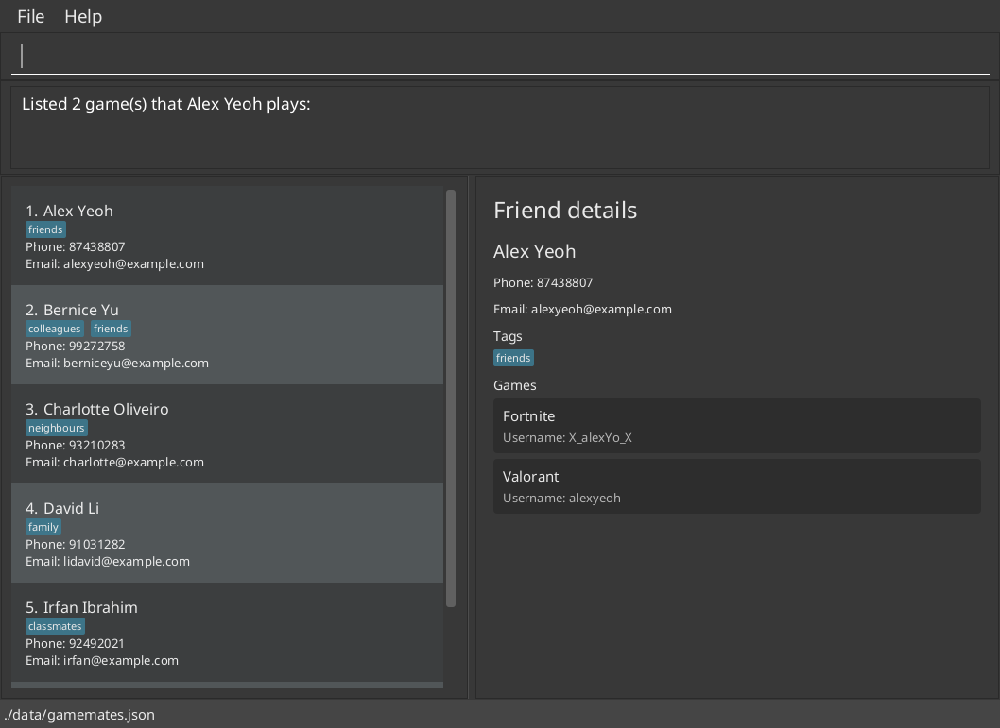
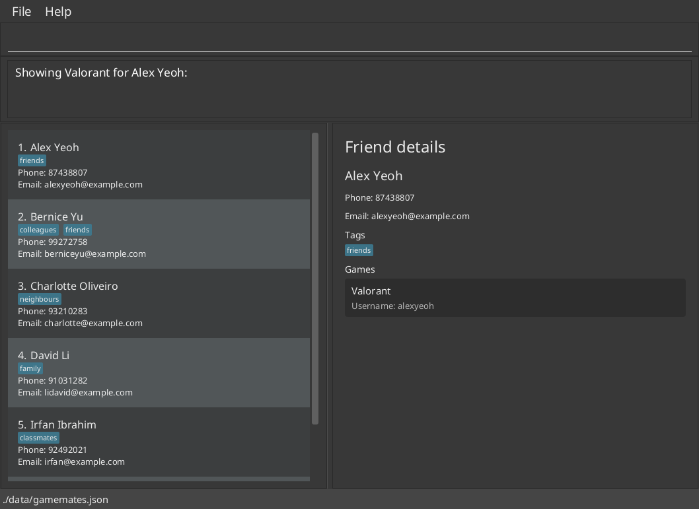
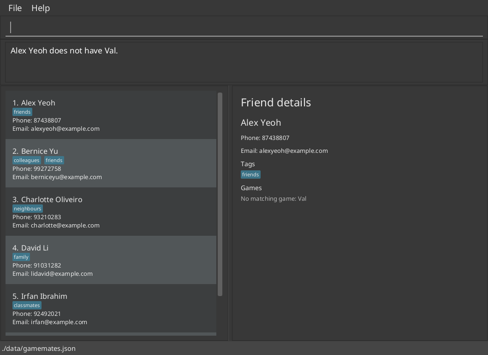
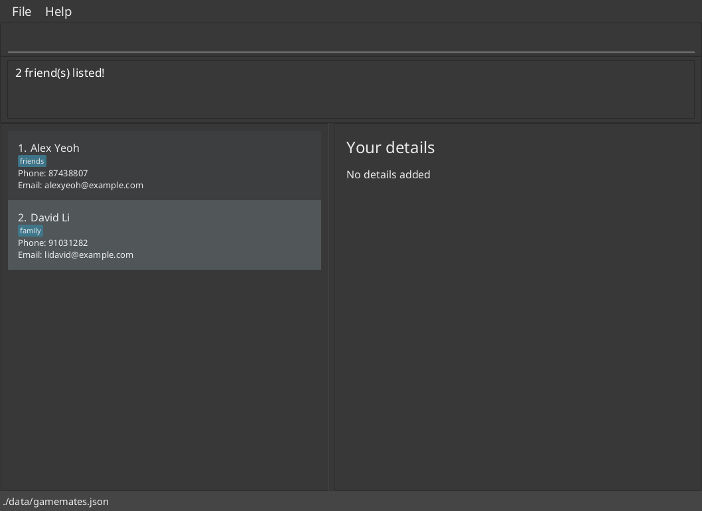

GameMates helps gamers keep track of friends, their contact details, the games they play and their in-game usernames.
Type commands to manage your friends, then use the split details panel to check who to invite to a game.
Your data stays on your computer. Browsing the online help and downloading releases require internet access.

This guide describes the commands available in this checkout. Use `gameadd`, `gamedel`, and `gameedit` to manage game
entries. `gameedit` can also replace or clear metadata. Metadata appears on game cards below the username.
See [Your profile and game entries](#your-profile-and-game-entries) for adding games to your profile.

* Table of Contents
{:toc}

--------------------------------------------------------------------------------------------------------------------

## Quick start

1. Ensure that Java `25` or later is installed on your computer.<br>
   **Mac users:** Ensure you have the precise JDK version prescribed [here](https://se-education.org/guides/tutorials/javaInstallationMac.html).

1. Download the latest `.jar` file from [here](https://github.com/AY2627S1-CS2103T-W14-3/tp/releases).

1. Copy the file to the folder you want to use as the _home folder_ for GameMates.

1. Open a terminal, `cd` to the folder containing the JAR file, and run `java -jar gamemates.jar`.<br>
   Keep launching from this folder: it is where GameMates reads and writes your data and preferences.<br>
   A GUI similar to the one below should appear in a few seconds. Note how the app contains some sample data.<br>
   

1. Type a command in the command box and press Enter to execute it. For example, type **`help`** and press Enter to open the help window.<br>
   Some example commands you can try:

   * `list` : Lists active friends.

   * `list g/Valorant` : Lists friends who play Valorant.

   * `pin 1` : Keeps the first displayed friend at the top of the list.
   * `list s/name` : Lists friends in ascending name order.

   * `gamelist 1 g/Valorant` : Shows the first displayed friend's Valorant card, if present.

   * `add n/John Doe p/98765432 e/johnd@example.com` : Adds a contact named `John Doe` to GameMates.

   * `delete 3` : Deletes the 3rd contact shown in the current list.

   * `clear` : Deletes all active and archived friends and their games immediately, while keeping your profile.

   * `exit` : Exits the app.

1. Refer to the [Features](#features) section below for details of each command.

--------------------------------------------------------------------------------------------------------------------

## Features

<div markdown="block" class="alert alert-info">

**:information_source: Notes about the command format:**<br>

* Words in `UPPER_CASE` are the parameters to be supplied by the user.<br>
  For example, in `add n/NAME`, replace `NAME` with a value such as `John Doe`.

* Items in square brackets are optional.<br>
  For example, `n/NAME [t/TAG]` can be used as `n/John Doe t/friend` or as `n/John Doe`.

* Items followed by `…`​ can appear zero or more times.<br>
  For example, `[t/TAG]…​` may be omitted, or written as `t/friend` or `t/friend t/family`.

* Prefixed parameters can be in any order. Positional indices must come first.<br>
  For example, if the command specifies `n/NAME p/PHONE_NUMBER`, `p/PHONE_NUMBER n/NAME` is also acceptable.

* Use spaces between parameters and lower-case command words and prefixes. Do not type square or angle brackets.
  Quotes are not needed around multiword names. Use only the prefixes documented for each command.
* To use prefix text such as ` n/` in a value, wrap the whole value in double quotes.
  For example, `g/"PUBG u/Game"` is the game name `PUBG u/Game`. Spaces at the start and end of the quoted value are removed.
* To include a double quote in a value, type it as `\"`. Other backslashes are kept as typed.
  For example, `g/\"Game` is the game name `"Game`.
* To end a quoted value with `\`, add a space before the closing quote.
  For example, `g/"PUBG u/Game\ "` is the game name `PUBG u/Game\`.
* For metadata, wrap the whole `KEY:VALUE`. For example, use `m/"Rank:Gold u/1"`, not `m/Rank:"Gold u/1"`.
* Quotes only applicable in values after a prefix. Friend indices, `myself` and `find` keywords read `"` as a normal character.
* A bare `"` in the middle of a value, a missing closing quote or text after the closing quote is rejected.
* Repeating a single-value `n/`, `p/` or `e/` parameter in `add` or `edit` is rejected, even with identical values.
  Tags may be repeated. Identical tag values are applied once.
* Friend indices refer to the current left-hand list and range from 1 to 2147483647 (inclusive). Run `list` to see all active friends
  again before choosing an index. Zero, negative numbers, decimals, a leading `+` and larger integers are rejected.
* For `edit`, `gameadd`, `gameedit` and `gamedel`, `FRIEND_INDEX|myself` means either a displayed friend index or the
  case-insensitive keyword `myself` for your own profile. Do not type `|`. The selector must come before prefixes.
  `myself` also works when no friends are displayed.

* Extraneous parameters for commands that take no parameters, such as `help`, `exit`, and `clear`, are ignored.<br>
  For example, `help 123` is interpreted as `help`.

* Wide tables scroll horizontally on narrow screens. If you are using a PDF version, take care when copying
  commands across line breaks: spaces can be lost during copying.
</div>

<div markdown="span" class="alert alert-warning">:exclamation: **Caution:**
Use straight double quotes `"`, not other types such as curly quotes `“ ”`. The app reads curly quotes as normal text, so the value
is not quoted. Text copied from a PDF or web page may contain curly quotes, so double check them before running a command.
</div>

### Viewing friend details

The main window has two panels: the friend list on the left and a details panel on the right.

* Click a friend in the left panel to view their name, phone number, email address, tags, games, in-game usernames and metadata
  in the right panel.
* On startup, the right panel shows your profile. If no profile details have been added, it shows `No details added`.
* When a `find` command returns exactly one friend, that friend's details are shown automatically.
* Commands keep the left-hand selection consistent with the details panel. Commands that show your profile
  clear the friend selection, so you can click that same friend again to reopen their details.
* Use `gamelist FRIEND_INDEX|myself [g/GAME_NAME]` to select a friend or your own profile and optionally
  show only one game.
  Clicking another friend shows all of that friend's games.
* Successful commands other than `gamelist`, a friend-targeted `gameedit` or a single-result `find` return the right panel to your profile.
  Clicking a friend selects their details again. Invalid commands keep the existing details display.
* `find` and `list g/GAME_NAME` each replace the previous friend-list filter. They do not combine filters.
  Adding a friend shows all active friends. Editing a friend clears filters in active/archive views, but keeps
  the name filter in Search results. Deleting a friend keeps the current friend-list filter.
* Without an explicit sort, pinned friends appear above unpinned friends, retaining the stored order within each group.
  A `list s/name` or `list s/game` sort currently orders the whole displayed list and can override pin placement.
  Run `list` without `s/` to return to the stored order.

### Your profile and game entries

Your profile is stored separately from your friend list. It appears on startup and after commands such as `list`.
If it contains no details, the right panel shows `No details added`. Filtering, deleting friends and `clear` do not
change your stored profile.

Set up your profile with `edit myself n/Joash` before using `gameadd`, `gameedit`, `gamedel` or `gamelist` with `myself`.
The first edit requires a valid, unique name. Later edits can omit it.
Before profile setup, `Myself` is not a reserved friend name. After setup, your profile name must differ from all friend names.
The `myself` selector is case-insensitive and works even when the friend list is empty or filtered.
Omitting the selector, as in `edit n/Joash`, is rejected. Profile edits preserve your games and the friend-list filter.

New friends start with no games. Use [`gameadd`](#adding-a-game-gameadd) and
[`gamedel`](#deleting-a-game-gamedel) to manage a friend's games or your own games, and
[`gamelist`](#viewing-games-gamelist) to view their entries or your own. Add metadata with optional `m/KEY:VALUE`
arguments in `gameadd`. Each game card shows its metadata below the username.
Deleting a friend removes that friend's complete entry, including their games. It does not remove games from
other friends. Back up your data before [editing a saved file](#editing-the-data-file).

### Viewing help: `help`

Opens a separate Help window with the online User Guide link. Click **Copy URL** and paste the link into a browser.
You can also open Help using the menu or `F1`. The command feedback is `Opened help window.`

Format: `help`


### Adding a friend: `add`

Adds a friend to GameMates.

Format: `add n/NAME [p/PHONE_NUMBER] [e/EMAIL] [t/TAG]…`

* Only the name is required. Omitted phone and email details are shown as `Not provided`.
* Supplied phone and email values must satisfy the validation rules. Empty `p/` or `e/` values are rejected.
* Leading and trailing spaces are removed. Names must be unique, ignoring case and repeated spaces:
  `John Doe` and `john   doe` identify the same friend.
* Once you set your Myself profile's name, a friend's name must differ from it under the same comparison rules.
* Different friends may share a phone number or email address.

<div markdown="span" class="alert alert-primary">:bulb: **Tip:**
A friend can have any number of tags, including zero.
</div>

Examples:

* `add n/John Doe`
* `add n/John Doe p/98765432 e/johnd@example.com`
* `add n/Betsy Crowe t/friend e/betsycrowe@example.com p/1234567 t/criminal`

Names are trimmed before validation, must not be blank and may contain at most 100 characters.
Only ASCII letters, digits and spaces are accepted. Names are compared case-insensitively,
so `john doe` and `John Doe` are the same friend.
To distinguish two people with the same name, use names such as `John Doe School` and `John Doe Work`.
Adding a different tag alone does not make a duplicate name unique; parentheses are not valid in names.

Tag names must contain 1–50 characters and use only ASCII letters and digits (no spaces or symbols).
Tags wrap within friend cards and the details panel when the available width is too narrow.

Phone numbers accept formats such as `91234567`, `+6591234567`, `+65 9123-4567` and `(123) 456-7890`.

* Use 3–15 ASCII digits without `+`, or 2–15 with `+`, including the country code.
* Put `+` at the start, immediately before a digit or `(`. The first digit after `+` must be `1`–`9`.
* Digit groups may have any length. Parentheses must enclose digits only and cannot be empty or nested.
* Use at most one hyphen or space between groups. Separators may differ or be omitted.
  Leading, trailing and consecutive separators are rejected.
* Dots, letters, non-ASCII digits and extensions are rejected.
* Command input is trimmed. Saved numbers must already match these rules.
* Formatting is preserved. `+6591234567` and `+65 9123-4567` are different phone values.

<div markdown="span" class="alert alert-warning">
Validation checks format only, not country codes, national number lengths or whether a number is active.
These rules also apply when editing friends and loading saved data.
</div>

Email addresses are trimmed before validation and must use ASCII `local-part@domain` syntax:

* The entire address may contain at most 254 characters, with at most 64 before `@`.
* The local part accepts letters, digits and the punctuation in ``!#$%&'*+/=?^_`{|}~-``.
  Dots may separate non-empty parts, so leading, trailing and consecutive dots are rejected.
* Each domain label (a part between dots) must contain 1–63 letters, digits or hyphens and must start
  and end with a letter or digit. Single-label domains such as `user@localhost` are accepted.
* Quoted local parts, address literals such as `user@[127.0.0.1]`, internal whitespace and non-ASCII
  characters are not supported. Validation checks format only, not whether a mailbox exists.

<div markdown="span" class="alert alert-info">
These rules use a practical subset of [RFC 5322's dot-atom syntax](https://www.rfc-editor.org/rfc/rfc5322#section-3.2.3)
and [RFC 5321's SMTP length limits](https://www.rfc-editor.org/rfc/rfc5321#section-4.5.3.1).
The 254-character address limit leaves room for the enclosing `<` and `>` in the 256-octet SMTP path limit.
</div>

### Listing, filtering and sorting friends: `list`

Shows active friends in GameMates, optionally filters the friend list by game, and can sort the displayed friends.
Both forms switch to the active view.

Format: `list [g/GAME_NAME] [s/NAME|GAME] [o/ASC|DESC]`

* `list` shows all active friends and clears any previous friend-list filter. Feedback is `Listed all active friends.`,
  including when the list is empty.
* `list g/GAME_NAME` shows active friends who have a game with that exact name. The match is case-insensitive, so `list g/valorant` matches `Valorant`.
* `list s/name` orders the displayed friends alphabetically by name, ignoring case.
* `list s/game` orders friends by the alphabetically first game in each friend's game list, ignoring case.
  Friends without games appear last in ascending order and first in descending order; name breaks ties.
* `o/asc` explicitly selects ascending order; this is the default. `o/desc` reverses the selected name or game
  order. An order may only be supplied with `s/`.
* `list g/GAME_NAME s/NAME|GAME` first filters by game, then sorts the matching friends. Prefixes may be supplied in
  either order.
* Running `find` changes only the friend-list filter and retains a sort applied by an earlier `list` command.
  Running `list` without `s/` clears that sort and returns to the stored insertion order.
* Leading and trailing spaces in `GAME_NAME` are ignored, but partial names do not match. For example, `list g/Val` does not match `Valorant`.
* Only game names are matched; a friend's in-game username is not matched.
* Multi-word game names are accepted. Only one `g/` prefix may be supplied, and the game name must not be empty.
* If no friends play the specified game, the friend list is empty and the command reports `0 friend(s) listed!`.
* Filtering applies only to the friend list. It does not filter or modify the separately stored Myself profile.
* Name filtering uses [`find`](#locating-friends-by-name-find), not `list n/NAME`. A new `find` or `list` replaces
  the previous friend-list filter; running them consecutively does not intersect their results.
* Game-name validation uses the same 1–50-character rules as `gamelist`. Empty `g/`, `s/`, or `o/`, extra positional
  input, unsupported sort/order values, an order without a sort, and repeated prefixes are rejected. Supported sort
  values are `name` and `game`; supported orders are `asc` and `desc`.
  A valid game filter returns `N friend(s) listed!`.

Examples:

* `list` shows all active friends.
* `list g/Valorant` shows friends who play `Valorant`.
* `list g/Stardew Valley` shows friends who play `Stardew Valley`.
* `list s/name` shows all friends sorted by name.
* `list s/game o/desc` shows all friends in descending game order.
* `list g/Valorant s/game` shows Valorant players sorted by their first game name.

### Pinning a friend: `pin`

Keeps a friend in the pinned group at the top of the stored friend order.
Explicit sorting can override the displayed position, as described under [`list`](#listing-filtering-and-sorting-friends-list).

Format: `pin FRIEND_INDEX`

* `FRIEND_INDEX` refers to the current displayed list. The command is unavailable for your separately stored Myself
  profile.
* At most five friends may be pinned. Attempting to pin a sixth friend, or pinning a friend who is already pinned,
  is rejected without changing the list.
  The limit counts active and archived friends together and also applies when loading saved data.
* Pinning is saved with your data. Pinned friends remain above unpinned friends after reopening GameMates and when
  filtering the list by game.
* A newly pinned friend is placed after friends already in the pinned group, while remaining above all unpinned
  friends.
* Pinned friend cards display a `Pinned` badge, making the boundary between pinned and unpinned friends visible.

Examples:

* `pin 1` pins the first displayed friend.
* `pin 3` pins the third displayed friend.

### Unpinning a friend: `unpin`

Removes a friend from the pinned group.

Format: `unpin FRIEND_INDEX`

* `FRIEND_INDEX` refers to the current displayed list.
* Unpinning a friend who is not pinned is rejected without changing the list.
* The friend is returned to the unpinned group, below all pinned friends.

Examples:

* `unpin 1` unpins the first displayed friend.

### Adding a game: `gameadd`

Adds a game with an optional in-game username and metadata (e.g. role or level) to a friend or your own profile.

Format: `gameadd FRIEND_INDEX|myself g/GAME_NAME [u/USER_NAME] [m/KEY:VALUE]…`

* For `myself`, [set up your profile first](#your-profile-and-game-entries).
* The game name is required. The username is optional. Omit `u/` if you do not know it.
* Game names and usernames must be 1–50 characters after trimming, with at least one letter or digit.
* Lengths use UTF-16 units. Supplementary Unicode characters count as two units.
* The text rules reject Unicode category C: controls, format characters such as zero-width spaces,
  unpaired surrogates, private-use characters and unassigned characters. Line and paragraph separators are also rejected.
* Blank-rendering Hangul fillers, blank Braille U+2800, the combining grapheme joiner U+034F and no-break spaces
  U+00A0, U+2007 and U+202F are rejected. Other combining marks, emoji and variation selectors are allowed
  when the field also contains a letter or digit and satisfies the length limit.
* Supplying `u/` without a value, or with only whitespace, is rejected. Omit the prefix instead.
* Repeated `g/` or `u/` prefixes are rejected, even when the values are identical.
* Each `m/KEY:VALUE` splits at the first colon and trims surrounding whitespace.
  Keys allow 1–50 characters and values allow 1–200. Both follow the game-name character rules.
  Only values may contain colons.
* Repeat `m/` for distinct keys. Metadata keys are case-insensitive, so `Role` and `role` are duplicates.
  Malformed pairs, empty fields or duplicate keys reject the whole command, even if values match.
  Omit `m/` entirely for no metadata.
* A space followed by `g/`, `u/` or `m/` starts a new parameter. Quote the whole value to include such text.
* A game name already present on the selected friend or profile is rejected, ignoring case.
* Other details and games are preserved. The friend-list filter stays unchanged.
* Metadata appears below the username, sorted by key ignoring case. Long fields wrap. Scroll for additional rows.
* The success message also lists supplied metadata below the username, sorted by key ignoring case.

<div markdown="span" class="alert alert-primary">:bulb: **Tip:**
Text copied from websites or game apps can contain hidden characters. If an input is rejected or a search does not match, retype it by hand.
</div>

Examples:

* `gameadd 1 g/Valorant u/player123`
* `gameadd 1 g/Valorant u/player123 m/Role:Support m/Level:20`
* `gameadd myself g/Minecraft u/myUsername m/Mode:Creative`
* `gameadd 1 g/Valorant` adds the game without a username.
* `gameadd myself g/Stardew Valley m/Role:Farmer` adds a game with metadata and no username.

### Deleting a game: `gamedel`

Removes one game from a friend or your own profile.

Format: `gamedel FRIEND_INDEX|myself g/GAME_NAME`

* For `myself`, [set up your profile first](#your-profile-and-game-entries).
* The game name is required and matched case-insensitively. A missing game is rejected.
* Other details and games are preserved. The friend-list filter stays unchanged.

Examples:

* `gamedel 1 g/Valorant`
* `gamedel myself g/Minecraft`

### Viewing games: `gamelist`

Shows a friend's or your own details and game cards in the right panel, keeping the friend list and its current
filter on the left.
Each game card shows the game name and in-game username if provided.

Format: `gamelist FRIEND_INDEX|myself [g/GAME_NAME]`

* For `myself`, [set up your profile first](#your-profile-and-game-entries).
* Use a positive `FRIEND_INDEX` from 1 to 2147483647 (inclusive) to select from the **currently displayed friend list**,
  including after `find` or `list g/GAME_NAME`, or use `myself` to select your own profile. The selector is required.
* `myself` is case-insensitive and works even when the friend list is empty or filtered. The panel shows `Your details`.
* Without `g/`, all of the selected person's games are shown. This also clears a previous game display filter.
* With `g/`, only a game with the complete matching name is shown. Matching is case-insensitive:
  `valorant` matches `Valorant`, but `Val` does not. Usernames are not searched.
* Game names follow the same rules as in `gameadd`. Surrounding whitespace is removed.
  Multiword names are accepted.
* Put the selector before the optional filter. Only one `g/` is allowed, even if repeated values are identical.
  Extra words before `g/` are rejected. All text after `g/` forms the game name, including text such as `x/`.
* An absent game is a successful empty result, including when the selected person has no games. Stored friend details,
  game entries and your Myself profile are unchanged. Invalid commands leave the previous details display unchanged.

Examples:

* `gamelist myself` shows all of your games.
* `gamelist myself g/Valorant` shows only your Valorant entry.
* `gamelist 1` shows all games of the first displayed friend.
* `gamelist 2 g/Valorant` shows only the second displayed friend's Valorant entry.
* `gamelist 2 g/minecraft` matches the stored name `Minecraft`.
* `gamelist 1 g/Stardew Valley` accepts a multiword name.
* `find David` followed by `gamelist 1` shows the games of the first friend in those search results.
* `list g/Minecraft` followed by `gamelist 1` shows all games of the first displayed Minecraft player,
  while the left panel continues showing only Minecraft players.





Feedback (placeholders below are replaced with actual values):

| Result | Feedback |
|--------|----------|
| All games | `Listed GAME_COUNT game(s) that FRIEND_NAME plays:` |
| Matching game | `Showing GAME_NAME for FRIEND_NAME:` (uses the stored game-name spelling) |
| No matching game | `FRIEND_NAME does not have GAME_NAME.` (uses your trimmed filter). The panel shows `No matching game: GAME_NAME` |
| No games, without a filter | `FRIEND_NAME has no games added yet.` The panel shows `No games added` |

Errors:

| Input problem | Feedback |
|---------------|----------|
| `myself` before profile setup | `Set your profile name first using "edit myself n/NAME" command.` |
| Missing selector or extra words before `g/` | <code>Invalid command format. Usage: gamelist FRIEND_INDEX&#124;myself [g/GAME_NAME]</code> |
| Malformed, zero, negative or overflowing index | `Index must be a positive integer between 1 and 2147483647 (inclusive).` |
| Positive index outside the displayed list | `No friend exists at index FRIEND_INDEX. Choose an index from 1 to MAX_LIST_INDEX.` |
| Numeric index with an empty displayed list | `No friends are currently displayed. Use list to show all friends.` |
| Invalid game name, including empty `g/` | `Game names must contain 1 to 50 printable characters and include at least one letter or digit.` |
| Repeated `g/` | `Multiple values specified for the following single-valued field(s): g/` |

For your own profile, feedback uses the name you set during setup.

### Editing a game: `gameedit`

Edits one existing game for a displayed friend or your separately stored profile.

Format: <code>gameedit FRIEND_INDEX&#124;myself g/EXISTING_GAME [n/NEW_GAME_NAME] [u/USERNAME] [m/KEY:VALUE]...</code>

* For `myself`, [set up your profile first](#your-profile-and-game-entries).
* Use the index from the **currently displayed** friend list, or case-insensitive `myself`. The profile can be edited even when the displayed list is empty.
* `g/` selects a complete existing game name, ignoring case. Partial names do not match. Supply at least one of `n/`, `u/` or `m/`. Repeatable `m/` pairs can appear in any order with the other prefixes; `g/`, `n/` and `u/` may each appear only once.
* Quote the whole value to include text such as ` n/`. For example, `g/"PUBG n/Game"` selects `PUBG n/Game`.
* `n/` renames the game. A name already used by another game of the same person is rejected. Changing only letter case is allowed and saves the new spelling.
* Omitted fields retain their values. Other games, contact details, tags, archive status and pin status are preserved.
  The current friend-list scope and filter are retained, including archived lists and search results.
  A renamed game can make its friend disappear from a game-filtered list.
* Usernames use the current 1–50 character validation and must contain a letter or digit. A supplied empty `u/` clears the username. Omitting `u/` preserves it.
* Supplying metadata **replaces the entire metadata set**. Omitting `m/` preserves it. A single empty `m/` clears all metadata. Do not mix an empty `m/` with pairs.
* Pairs split at the first colon: `m/Region:Asia:SG` means key `Region`, value `Asia:SG`. Keys and values are trimmed independently. Keys use 1–50 characters and cannot contain colons; values use 1–200 characters. Both require a letter or digit and reject control characters, using the existing game metadata validation.
* Keys are unique ignoring case: `m/Role:Healer m/role:Healer` is rejected even though the values agree. Values preserve case.
* Every edit is validated before any data changes. On success, the right panel shows the updated friend (all games) or your updated profile. Feedback includes the resulting game name, username and metadata. Metadata is saved and displayed on game cards below the username.

Examples:

* `gameedit 1 g/Valorant u/newPlayer` changes only the username.
* After `gameadd 1 g/PUBG n/Game u/player`, use `gameedit 1 g/"PUBG n/Game" u/newPlayer` to edit that exact entry, even if the friend also plays `PUBG`.
* `gameedit myself g/Valorant n/VALORANT m/Role:Healer m/Region:Asia:SG` changes spelling and replaces metadata.
* `gameedit 1 g/Valorant m/` clears metadata while preserving the game name and username.

Errors include an invalid displayed index, missing selector, missing game, invalid field, repeated singleton prefix,
repeated metadata key, and a rename collision. Saved files with duplicate game names are rejected during loading.
Failed commands preserve the stored data and previous details view.
### Finding a random squad: `squad`

Randomly selects friends who play a game from the currently displayed friend list and forms a squad including you.
Lists each member's name, in-game username when available, and displayed friend index where applicable.

Format: `squad g/GAME n/NUMBER_OF_PEOPLE`

* Both `g/` and `n/` are required and may appear in either order.
* `GAME` follows the same rules as in `gameadd`. Multiword names are accepted.
* Matching uses the complete game name and is case-insensitive.
  `valorant` matches `Valorant`, but `Val` does not.
* `NUMBER_OF_PEOPLE` must be a whole number from 1 to 20, inclusive.
* The requested size includes you: `n/3` selects you and two friends; `n/1` returns only you.
* You are always included as the first member, labelled `Me`, even if your profile does not contain `GAME`.
* The other `NUMBER_OF_PEOPLE - 1` members are selected from the **currently displayed friend list**. To include your entire friend list, run `list` first.
  Each must play `GAME`. A person cannot appear more than once in a squad.
* Selection is random. Repeating the command may return a different squad, but may also return the same one.

Examples:

* `squad g/Valorant n/3`
* `squad g/Stardew Valley n/4`

Assuming Benedict and Melody are at indices 1 and 2 in the currently displayed friend list.
Example success feedback for `squad g/Valorant n/3`:

```text
Found squad of 3 people:
1. Me (username: aaravm123)
2. Benedict (username: benthecat, index: 1)
3. Melody (username: melodyps, index: 2)
```

If your profile has no entry for the requested game, the first row is simply `1. Me`.
If fewer than `NUMBER_OF_PEOPLE - 1` displayed friends play the requested game, feedback is:

```text
Could not find a squad of <n> people.
```

`<n>` is replaced with the requested squad size, for example `Could not find a squad of 3 people.`

Possible errors:

| Input problem | Feedback |
|---------------|----------|
| Missing `g/` or `n/`, or a missing parameter value | `Invalid command format. Usage: squad g/GAME n/NUMBER_OF_PEOPLE` |
| Invalid squad size, such as `0`, `21`, `-1`, `2.5` or `abc` | `Invalid squad size. Enter a whole number from 1 to 20.` |
| Invalid game name | `Invalid game name GAME_NAME. Enter 1–50 printable characters containing at least one letter or digit.` |

### Editing a friend or your own profile: `edit`

Edits an existing friend or your separately stored Myself profile in GameMates.

Format: `edit FRIEND_INDEX|myself [n/NAME] [p/[PHONE_NUMBER]] [e/[EMAIL]] [t/TAG]…`

* Edits the friend at the specified `FRIEND_INDEX`. The index refers to the index number shown in the displayed friend list. The index **must be a positive integer** 1, 2, 3, …​
* Use `myself` instead of `FRIEND_INDEX` to edit your own profile, for example `edit myself n/Alex Tan`. The selector is case-insensitive.
* The first `edit myself` must include `n/NAME`. After setup, later edits can omit the name, and you can use
  `gameadd`, `gameedit`, `gamedel` and `gamelist` with `myself`.
* `|` means "or": enter either a friend index or `myself`. Do not type the `|` character.
* At least one of the optional fields must be provided.
* Supplied values are trimmed and validated using the same rules as `add`.
* Omitted fields remain unchanged. Enter `p/` or `e/` without a value to remove that contact detail.
* A name cannot be removed. The new name must be unique among other friends, ignoring case and repeated spaces.
* Your own profile's name must also be unique among all friends, ignoring case and repeated spaces. Adding or renaming a friend to match your own profile's name is rejected.
* Games remain unchanged when editing friend details.
* Success feedback starts with `Edited NAME` and lists only changed details. Removed contact details are reported
  as `removed phone number` or `removed email`.
* A friend index or `myself` is required. Editing Myself works even when no friends are displayed and preserves the current friend-list filter.
* Omit `t/` to keep the friend's existing tags. Each supplied `t/TAG` removes that tag if the friend already has it, or adds it if they do not. Other tags remain unchanged.
* Tag matching is case-sensitive. Repeating the same tag in one command applies it only once.
* To remove all of a friend's tags, enter `t/` without a tag after it.
  Use that empty prefix on its own. Combining it with non-empty tags is rejected.
* A successful friend edit shows all friends in the current active or archive view again. In **Search results**,
  it preserves the search filter. A renamed friend disappears if their new name no longer matches.
  Editing preserves the friend's archive status, games and your profile. A successful
  `edit myself` shows your updated profile on the right and keeps the current friend-list filter.

Examples:

* `edit 1 p/91234567 e/johndoe@example.com` Edits the phone number and email address of the 1st friend to be `91234567` and `johndoe@example.com` respectively.
* `edit 2 n/Betsy Crower t/` Edits the name of the 2nd friend to be `Betsy Crower` and clears all existing tags.
* `edit 2 p/ e/` removes the 2nd friend's phone number and email.
* `edit 2 t/teammate` removes `teammate` if the 2nd friend already has it, or adds it otherwise. Other tags remain unchanged.
* `edit myself n/Alex Tan p/91234567` updates your own name and phone number.
* `edit myself p/ e/ t/` clears your own phone number, email and tags while preserving your name and games.

Errors:

* Missing index: `Please provide an index.`
* Invalid index (including a value above 2147483647): `Index must be a positive integer between 1 and 2147483647 (inclusive).`
* Empty displayed list: `No friends are currently displayed. Use list to show all friends.`
* Index outside the displayed list: `No friend exists at index FRIEND_INDEX. Choose an index from 1 to MAX_LIST_INDEX.`
* No fields provided: `No details were passed to the command. Specify at least one parameter ([n/NAME], [p/[PHONE]], [e/[EMAIL]], [t/TAG]...) to edit specific details.`
* First profile edit without a name: `Set your profile name first using "edit myself n/NAME" command.`
* Duplicate name: `This friend already exists in GameMates.`
* Adding or renaming a friend to your profile's name: `This name is already used by your Myself profile.`

### Locating friends by name: `find`

Finds active and archived friends whose names contain any of the given keywords, regardless of the current view.

Format: `find KEYWORD [MORE_KEYWORDS]`

* The search is case-insensitive; for example, `hans` matches `Hans`.
* Keyword order does not matter; for example, `Hans Bo` matches `Bo Hans`.
* The search considers only names.
* Only full words match; for example, `Han` does not match `Hans`.
* Friends matching at least one keyword are returned (an `OR` search); for example, `Hans Bo` returns `Hans Gruber` and `Bo Yang`.
* Searching starts from all active and archived friends, replacing any previous name or game filter.
  `find` does not accept `n/` or `g/` as filter syntax; such text is treated as literal name keywords.
* Results appear under **Search results**, with an **Archived** badge on archived friends.
* `archive FRIEND_INDEX` archives an active result; `unarchive FRIEND_INDEX` restores an archived result. The friend stays in
  the search results with their updated status, and the search filter and displayed order stay in place.
* Archiving an already archived search result reports `This friend is already archived.` without changing data.
* `list` returns to active friends; `archivelist [g/GAME_NAME]` switches to archived friends only.
* Feedback is `N friend(s) listed!`. No matches is a successful empty search view. Exactly one result also opens that
  friend's complete details and games on the right. An empty keyword list is rejected with usage instructions.

Examples:

* `find John` returns `john` and `John Doe`
* With the initial sample data, `find alex david` returns `Alex Yeoh`, `David Li`.<br>
  

### Archiving a friend: `archive`

Hides a friend from the active list while keeping their contact details, tags, games, usernames and game metadata.

Format: `archive FRIEND_INDEX`

* The index refers to the currently displayed active list or **Search results**, including game-filtered
  active lists. It must be a positive integer.
* From the archive-only view, `archive` reports `Run list to switch to the active list before archiving a friend.` before checking
  whether the index exists. This also applies when that view is empty; data and view stay unchanged.
* The friend disappears from the active view immediately. In **Search results**, the friend stays visible with
  an **Archived** badge. The current filter stays in place.
* Feedback is `Archived FRIEND_NAME.`. Archiving an already archived friend is rejected.
* Your Myself profile cannot be archived. `myself`, missing indices, extra arguments and invalid indices are rejected.
* Missing indices report `Please provide an index.`. Invalid indices (such as `-1`, `0` or `abc`) report
  `Index must be a positive integer between 1 and 2147483647 (inclusive).`.
* Archived friends keep their names reserved. Adding or renaming another friend to the same name is rejected
  with a suggestion to use `archivelist` and `unarchive`.
* `list` and `list g/GAME_NAME` show active friends only. `find` searches both active and archived friends.

Example: `list`, then `archive 1` archives the first displayed active friend.

### Listing and filtering archived friends: `archivelist`

Shows archived friends, optionally filtered by game. It follows the same syntax and game-matching rules as `list`.

Format: `archivelist [g/GAME_NAME]`

* `archivelist` shows all archived friends in the existing list panel, headed **Archived friends**.
* `archivelist g/GAME_NAME` shows archived friends who have a game with that exact name, ignoring case.
  Leading and trailing spaces are ignored. Multi-word game names are accepted; partial names and usernames do not match.
* Each invocation starts from all archived friends and replaces any previous name or game filter.
* Only one `g/` prefix may be supplied. Empty game names, repeated prefixes and extra positional arguments are rejected,
  using the same validation rules as `list`.
* Name keywords and `n/` are not supported here. Use `find KEYWORD [MORE_KEYWORDS]` to search names across both active
  and archived friends.
* Non-empty results report `Listed N archived friend(s).`.
* With no archived friends, unfiltered `archivelist` reports
  `No archived friends. Use the command "list", then "archive FRIEND_INDEX" to archive a friend.`
* A game filter with no matches reports `No archived friends match this game filter.`.
  Both empty cases are successful commands and keep the **Archived friends** heading.
* Indices refer to this displayed archive list. Select a friend or use `gamelist 1` to inspect preserved games.
* `edit`, `gameadd`, `gameedit` and `gamedel` work on displayed archived friends and keep them archived. Editing friend
  details clears the game filter within the archive view. `delete` permanently removes a displayed archived friend.
* `list` returns to the active view, headed **Active friends**. Adding a friend also returns to the active view.

Examples:

* `archivelist` shows all archived friends.
* `archivelist g/Valorant` shows archived friends who play Valorant.
* `archivelist g/Stardew Valley` shows archived friends who play Stardew Valley.

### Restoring an archived friend: `unarchive`

Format: `unarchive FRIEND_INDEX`

* Use `archivelist`, `archivelist g/GAME_NAME`, or `find KEYWORD` to display archived friends.
* The index refers to that displayed list. It must be a positive integer.
* The friend returns to the active list with all their details intact. They disappear from an archive-only view,
  but stay visible in **Search results** with the **Archived** badge removed. The current filter stays in place.
  Run `list` to see active friends.
* Feedback is `Restored FRIEND_NAME.`. Selecting an active friend is rejected with a suggestion to use `archivelist`.
* `myself`, missing indices, extra arguments and invalid indices are rejected. Missing indices report
  `Please provide an index.`; invalid indices report
  `Index must be a positive integer between 1 and 2147483647 (inclusive).`.
* Out-of-range indices, including
  empty lists, report `The friend index provided is invalid.` without changing data or the current view.

Example: `archivelist g/Valorant`, then `unarchive 1` restores the first displayed archived friend who plays Valorant.

### Deleting a friend: `delete`

Deletes the specified friend from GameMates.

Format: `delete FRIEND_INDEX`

* Deletes the friend at the specified `FRIEND_INDEX`.
* The index refers to the index number shown in the displayed friend list.
* The index **must be a positive integer** 1, 2, 3, …​
* Leading and trailing spaces are ignored. The index must have a value from 1 to 2147483647 (inclusive).
* A successful deletion displays `Successfully deleted FRIEND_NAME.`
* Deletion happens immediately, with no confirmation dialog and no undo command. The friend's games are deleted
  with the friend; other friends and your stored profile are preserved. The current friend-list filter stays active.

Examples:

* `list` followed by `delete 2` deletes the 2nd friend in GameMates.
* `find Betsy` followed by `delete 1` deletes the 1st friend in the results of the `find` command.

Errors:

* Missing index: `Please provide an index.`
* Invalid index (such as `0`, `-1`, or `abc`), extra arguments, or a value above 2147483647:
  `Index must be a positive integer between 1 and 2147483647 (inclusive).`
* Index outside the displayed list, including an empty list: `The friend index provided is invalid.`

### Clearing the friend list: `clear`

Clears all active and archived friends from GameMates and preserves your Myself profile.

Format: `clear`

The command takes effect immediately, with no confirmation or undo. Feedback is `All active and archived friends have been cleared!`.
All active and archived friends and their game entries are removed. Back up your data file first if you may need them again.

### Exiting the program: `exit`

Exits the program.

Format: `exit`

### Saving the data

GameMates saves the complete friend list, games and stored profile after every command that parses and executes
successfully, including viewing commands such as `list` and `gamelist`. You do not need a save command.
The active friend-list filter, selection and game display filter are not saved; a new launch shows all active friends and
your profile. Window size and position are stored separately in `preferences.json` when you close the main window
or use `exit`.

If saving fails, an error beginning `Could not save data` appears. A friend change may already be visible in the
running application even though it was not written to disk. Restore write access to the data folder and run a
successful command such as `list` to try saving again before closing the app.

### Editing the data file

GameMates uses `data/gamemates.json` relative to the folder from which you launch it. If you follow Quick start,
this is the folder containing the JAR. Launching the same JAR from a different folder uses different data.
The status bar shows the data path. Friends are stored under `friends`, and your profile is stored under `myself`.

To back up or transfer your data, close the app and copy `data/gamemates.json` to a safe location. To restore it,
close the destination app, back up its current file, replace it with your copy and relaunch from the same folder.
Copy `preferences.json` only if you also want the saved window settings.

If you edit JSON manually, close the app first and keep a backup. Friend entries contain `name`, optional
`phone` and `email`, `tags`, `games`, and `archived` and `pinned` booleans. Missing `archived` defaults to `false`
(active), while missing `pinned` defaults to `false` (unpinned); both statuses are saved across restarts. A game has a
required `name` and an optional `username`.
An empty or missing `username` means no username has been provided; the game entry is still retained.
Existing files that omit `games` load with no games; files that omit `myself` use the default empty profile.
The untouched default profile is omitted when saving. Stored friends and profiles must have a valid non-empty name.
Friend names must be unique and must differ from the stored profile name.
Each person can have only one entry for a game name, ignoring case, even if the usernames differ.
At most five friends across active and archived entries can have `pinned: true`.
Violating any of these rules rejects the entire data file.
Empty or missing contact fields mean
`Not provided`. Use the same validation rules as command input. Stored game metadata is supported as an optional
`metas` array, for example `"metas": [{"key": "Role", "value": "Support:Mid"}]`. Keys contain 1–50 characters
and values 1–200 after trimming, with at least one letter or digit and no control characters. Keys cannot contain
colons and must be unique per game, ignoring case; values may contain colons. Missing `metas` loads as empty.
Metadata can be entered with `gameadd` or replaced or cleared with `gameedit`; it is preserved when saving and
displayed on game cards. The metadata text rules are the same as in [`gameadd`](#adding-a-game-gameadd).

A data file containing only `null` is invalid and uses the empty-data fallback.
If `preferences.json` contains only `null`, or has `"guiSettings": null`, startup uses and saves default preferences.

<div markdown="span" class="alert alert-warning">:exclamation: **Caution:**
If the file is missing, the app starts with sample friends and the default profile. If it cannot load the file
because of malformed JSON or invalid stored values, it starts with an empty friend list and default profile.
The original file is not automatically repaired or backed up. The next successful command can overwrite it with
the current data, so close the app and restore your backup before entering commands if you need to recover it.
Unknown JSON fields are ignored and are not preserved on the next save. Use the supported `metas` format for metadata.
</div>

### Archiving data files `[coming in v2.0]`

Future proposal only: automatic archiving is not implemented. Use the manual backup procedure above.

--------------------------------------------------------------------------------------------------------------------

## FAQ

**Q**: How do I transfer my data to another computer?<br>
**A**: Follow the backup and restore steps in [Editing the data file](#editing-the-data-file). Keep both apps closed
while copying the file, then launch the destination app from its usual data folder.

--------------------------------------------------------------------------------------------------------------------

## Known limitations

1. **Only one instance of GameMates can run at a time.** Multiple instances write to the same `data/gamemates.json`
   and may overwrite each other's changes, causing data loss.
2. **GameMates primarily supports English.** Friend names, tags, phones and emails accept only ASCII characters.
   Game names, usernames and metadata accept other Unicode characters, but other languages are not formally tested.
3. **Some characters count as more than one toward length limits.** Lengths are counted in UTF-16 code units, so
   `😀` counts as 2 and `👨‍👩‍👧` (built from 3 emoji and 2 joiners) counts as 8.

--------------------------------------------------------------------------------------------------------------------

## Known issues

1. **When using multiple screens**, if you move the application to a secondary screen, and later switch to using only the primary screen, the GUI will open off-screen. The remedy is to delete the `preferences.json` file created by the application before running the application again.
2. **If you minimize the Help Window** and then run the `help` command (or use the `Help` menu, or the keyboard shortcut `F1`) again, the original Help Window will remain minimized, and no new Help Window will appear. The remedy is to manually restore the minimized Help Window.

--------------------------------------------------------------------------------------------------------------------

## Command summary

| Action | Format, Examples |
|--------|------------------|
| **Add** | `add n/NAME [p/PHONE_NUMBER] [e/EMAIL] [t/TAG]…` <br> e.g., `add n/James Ho t/friend` |
| **Archive** | `archive FRIEND_INDEX` |
| **Archive list/filter** | `archivelist [g/GAME_NAME]` |
| **Unarchive** | `unarchive FRIEND_INDEX` |
| **Clear** | `clear` |
| **Delete** | `delete FRIEND_INDEX`<br> e.g., `delete 3` |
| **Edit** | <code>edit FRIEND_INDEX&#124;myself [n/NAME] [p/[PHONE_NUMBER]] [e/[EMAIL]] [t/TAG]…</code><br> e.g., `edit myself n/Joash` or `edit 2 n/James Lee e/jameslee@example.com` |
| **Find** | `find KEYWORD [MORE_KEYWORDS]`<br> e.g., `find James Jake` |
| **Game edit** | <code>gameedit FRIEND_INDEX&#124;myself g/EXISTING_GAME [n/NEW_GAME_NAME] [u/USERNAME] [m/KEY:VALUE]...</code><br> e.g., `gameedit myself g/Valorant m/Role:Healer` |
| **Game add** | <code>gameadd FRIEND_INDEX&#124;myself g/GAME_NAME [u/USER_NAME] [m/KEY:VALUE]…</code><br> e.g., `gameadd myself g/Valorant u/player123 m/Role:Support` |
| **Game delete** | <code>gamedel FRIEND_INDEX&#124;myself g/GAME_NAME</code><br> e.g., `gamedel myself g/Valorant` |
| **Game list** | <code>gamelist FRIEND_INDEX&#124;myself [g/GAME_NAME]</code><br> e.g., `gamelist myself g/Valorant` |
| **Squad create** | `squad g/GAME_NAME n/NUMBER_OF_PEOPLE`<br> e.g., `squad g/Valorant n/5` |
| **List** | `list [g/GAME_NAME] [s/NAME|GAME] [o/ASC|DESC]`<br> e.g., `list g/Valorant s/name o/desc` |
| **Pin** | `pin FRIEND_INDEX`<br> e.g., `pin 1` |
| **Unpin** | `unpin FRIEND_INDEX`<br> e.g., `unpin 1` |
| **Help** | `help` |
| **Exit** | `exit` |
